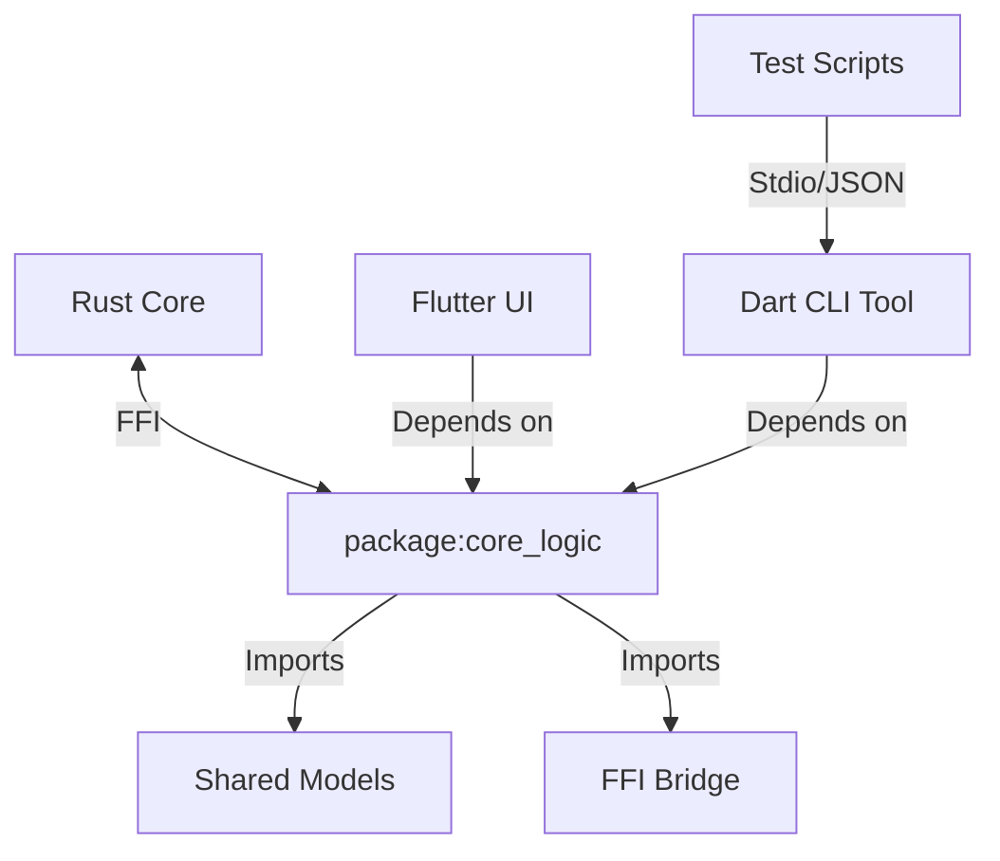

# Design Document

## Overview

The design involves refactoring the existing Flutter application structure to extract the FFI bridge and data models into a shared, pure Dart package (`core_logic`). A new Dart CLI application (`apps/cli_tool`) will be created to consume this shared package, providing a headless interface for testing and automation.

## Steering Document Alignment

### Technical Standards (tech.md)
This design implements the "Headless Dart Harness Strategy" defined in the updated `tech.md`. It adheres to the 3-Layer Hybrid Architecture by explicitly separating the Core Layer access (FFI) from the UI Layer.

### Project Structure (structure.md)
The new directory structure follows the updated `structure.md`:
- `packages/core_logic/`: Shared code.
- `apps/cli_tool/`: New CLI entry point.
- `ui/`: Depends on `core_logic`.

## Code Reuse Analysis

### Existing Components to Leverage
- **FFI Bindings**: The existing `rust_lib` (or equivalent) generated bindings will be moved to `core_logic`.
- **Freezed Models**: Existing data models in `ui/lib/models` will be moved to `core_logic/lib/models` to be shared.
- **Service Logic**: Any non-UI business logic currently in `ui/lib/services` that doesn't depend on Flutter widgets will be candidate for migration.

### Integration Points
- **Rust Core**: The FFI bridge remains the primary integration point. The `core_logic` package will handle the `dart:ffi` initialization.
- **Flutter UI**: The UI will need to be refactored to import from `package:core_logic` instead of local relative paths for models and FFI.

## Architecture

### Modular Design Principles
- **Package-Based Architecture**: Separation is enforced by Dart package boundaries. `core_logic` cannot accidental import Flutter classes because it won't have `flutter` in its `pubspec.yaml`.
- **Command Pattern**: The CLI will use a Command pattern to map JSON inputs to executable actions.



## Components and Interfaces

### Package: core_logic
- **Purpose:** Encapsulate FFI bindings and shared domain models.
- **Interfaces:**
  - `KeyrxCore.init()`: Initialize FFI.
  - `KeyrxCore.api`: Access to Rust methods.
  - `Models`: UserProfile, Config, etc.
- **Dependencies:** `ffi`, `freezed_annotation`.

### App: cli_tool
- **Purpose:** Headless execution of core logic.
- **Interfaces:** CLI arguments (`--json`, `--cmd`).
- **Dependencies:** `core_logic`, `args`.

## Data Models

### JSON Command Protocol
The CLI will accept a standardized JSON wrapper for commands:
```json
{
  "command": "update_profile",
  "payload": {
    "name": "Alice",
    "age": 30
  }
}
```

### JSON Response Protocol
```json
{
  "status": "success",
  "data": { ... }
}
```
OR
```json
{
  "status": "error",
  "error": "Validation failed"
}
```

## Error Handling

### Error Scenarios
1. **FFI Load Failure:**
   - **Handling:** `core_logic` throws a specific `FfiInitError`. CLI catches and prints `{"status": "error", "code": "FFI_LOAD_FAILED"}`.
2. **Invalid JSON Input:**
   - **Handling:** CLI validation layer rejects before calling core. Prints `{"status": "error", "code": "INVALID_JSON"}`.

## Testing Strategy

### Unit Testing (Dart)
- Test `core_logic` models and parsers using standard `dart test`.

### Integration Testing (Headless)
- Write Dart tests in `apps/cli_tool/test` that invoke the core logic via FFI (requires built Rust library).
- Shell scripts that pipe JSON to the compiled CLI binary and assert on output using `jq`.
