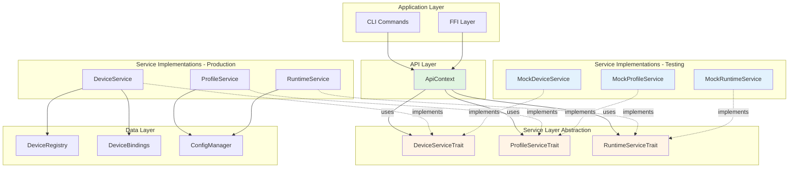

# Design Document

## Overview

This design implements dependency injection for KeyRx's service layer, replacing global singleton services with trait-based abstractions and constructor injection. The implementation follows SOLID principles, maintains 100% backward compatibility, and enables fast isolated unit testing.

**Core Design Principles:**
1. **Trait-based abstractions** - Define service contracts as traits
2. **Constructor injection** - Services accept dependencies as parameters
3. **Zero behavior changes** - Refactor structure, not logic
4. **Backward compatibility** - Existing code continues working
5. **Test-first architecture** - Design enables easy mocking

## Steering Document Alignment

### Technical Standards (~/.claude/CLAUDE.md)

**Architecture Requirements Met:**
- ✅ **SOLID Principles**: Implements Dependency Inversion (DIP) and Interface Segregation (ISP)
- ✅ **Dependency Injection**: All external deps injected as mandated
- ✅ **No testability blockers**: Removes global singletons, enables mocking
- ✅ **Error Handling**: Maintains existing error hierarchy
- ✅ **Code Quality**: Max 500 lines/file, max 50 lines/function enforced

**Testing Requirements Met:**
- ✅ **Unit tests**: Pure, isolated, mockable dependencies
- ✅ **80% coverage minimum**: Framework enables comprehensive testing
- ✅ **No globals**: Services are injected, not accessed via statics

### Project Structure

**Module Organization:**
```
core/src/
├── services/
│   ├── mod.rs             # Re-exports all service types
│   ├── traits.rs          # Service trait definitions
│   ├── device.rs          # DeviceService implementation
│   ├── profile.rs         # ProfileService implementation
│   ├── runtime.rs         # RuntimeService implementation
│   └── mocks.rs           # Test mock implementations
├── api.rs                 # ApiContext with DI
└── ...
```

**File Size Targets:**
- `services/traits.rs`: ~300 lines (3 traits × ~100 lines each)
- `services/mocks.rs`: ~400 lines (3 mocks × ~130 lines each)
- `api.rs`: ~250 lines (refactored from 197 lines)
- Each file stays well under 500-line limit ✅

## Code Reuse Analysis

### Existing Components to Leverage

- **`DeviceService` (core/src/services/device.rs)**: Extract trait interface from existing implementation
  - Reuse: All existing methods become trait methods
  - Extend: Add constructor parameter for `DeviceBindings`
  - Preserve: Zero logic changes to existing implementation

- **`ProfileService` (core/src/services/profile.rs)**: Extract trait interface
  - Reuse: All existing methods become trait methods
  - Extend: Add constructor parameter for `ConfigManager`
  - Preserve: Zero logic changes

- **`RuntimeService` (core/src/services/runtime.rs)**: Extract trait interface
  - Reuse: All existing methods become trait methods
  - Extend: Add constructor parameters for dependencies
  - Preserve: Zero logic changes

- **`api.rs` functions**: Convert to methods on `ApiContext`
  - Reuse: All 28 existing functions become `ApiContext` methods
  - Extend: Accept `&self` to access injected services
  - Preserve: Top-level convenience functions for backward compatibility

### Integration Points

- **FFI Layer (core/src/ffi/)**: Will use `ApiContext::with_defaults()` for production
  - Integration: FFI context can hold `ApiContext` instance
  - Benefit: FFI can provide different contexts for testing
  - Change: Minimal - just use `ApiContext` instead of direct function calls

- **CLI Commands (core/src/cli/)**: Will use `ApiContext::with_defaults()` for production
  - Integration: CLI commands instantiate `ApiContext` at startup
  - Benefit: CLI tests can inject mocks
  - Change: Minimal - pass `ApiContext` to command handlers

- **Test Suite (core/tests/)**: Will use `ApiContext::new()` with mocks
  - Integration: Tests create `ApiContext` with `MockService` implementations
  - Benefit: Fast, isolated tests with controlled behavior
  - Change: Major - all tests refactored to use DI, but much simpler

## Architecture

### Overall Architecture Pattern: Service-Oriented with Dependency Injection



### Modular Design Principles

1. **Single File Responsibility**:
   - `traits.rs`: Only service trait definitions
   - `mocks.rs`: Only mock implementations
   - Each service file: Only that service's implementation

2. **Component Isolation**:
   - Traits define contracts independently of implementations
   - Mocks are completely isolated from real implementations
   - Services don't know about their consumers

3. **Service Layer Separation**:
   - **API Layer** (`api.rs`): Orchestrates service calls, owns service instances
   - **Service Traits** (`traits.rs`): Define contracts
   - **Service Implementations** (`device.rs`, `profile.rs`, `runtime.rs`): Business logic
   - **Data Layer** (existing): Configuration, registry, bindings

4. **Dependency Flow**: Unidirectional, top-down
   - Application → API → Service Traits → Service Implementations → Data Layer
   - No circular dependencies
   - Each layer only knows about its immediate dependencies

## Components and Interfaces

### Component 1: Service Traits

**File:** `core/src/services/traits.rs` (~300 lines)

**Purpose:** Define service contracts as Rust traits that all implementations must follow.

**Interfaces:**
```rust
/// Device management service contract
#[async_trait]
pub trait DeviceServiceTrait: Send + Sync {
    async fn list_devices(&self) -> Result<Vec<DeviceView>, DeviceServiceError>;
    async fn get_device(&self, device_key: &str) -> Result<DeviceView, DeviceServiceError>;
    async fn set_remap_enabled(&self, device_key: &str, enabled: bool) -> Result<DeviceView, DeviceServiceError>;
    async fn assign_profile(&self, device_key: &str, profile_id: &str) -> Result<DeviceView, DeviceServiceError>;
    async fn unassign_profile(&self, device_key: &str) -> Result<DeviceView, DeviceServiceError>;
    async fn set_label(&self, device_key: &str, label: Option<String>) -> Result<DeviceView, DeviceServiceError>;
}

/// Profile management service contract
pub trait ProfileServiceTrait: Send + Sync {
    fn list_virtual_layouts(&self) -> Result<Vec<VirtualLayout>, ProfileServiceError>;
    fn save_virtual_layout(&self, layout: VirtualLayout) -> Result<VirtualLayout, ProfileServiceError>;
    fn delete_virtual_layout(&self, id: &str) -> Result<(), ProfileServiceError>;
    fn list_hardware_profiles(&self) -> Result<Vec<HardwareProfile>, ProfileServiceError>;
    fn save_hardware_profile(&self, profile: HardwareProfile) -> Result<HardwareProfile, ProfileServiceError>;
    fn delete_hardware_profile(&self, id: &str) -> Result<(), ProfileServiceError>;
    fn list_keymaps(&self) -> Result<Vec<Keymap>, ProfileServiceError>;
    fn save_keymap(&self, keymap: Keymap) -> Result<Keymap, ProfileServiceError>;
    fn delete_keymap(&self, id: &str) -> Result<(), ProfileServiceError>;
}

/// Runtime configuration service contract
pub trait RuntimeServiceTrait: Send + Sync {
    fn get_config(&self) -> Result<RuntimeConfig, RuntimeServiceError>;
    fn add_slot(&self, device: DeviceInstanceId, slot: ProfileSlot) -> Result<RuntimeConfig, RuntimeServiceError>;
    fn remove_slot(&self, device: DeviceInstanceId, slot_id: &str) -> Result<RuntimeConfig, RuntimeServiceError>;
    fn reorder_slot(&self, device: DeviceInstanceId, slot_id: &str, new_priority: u32) -> Result<RuntimeConfig, RuntimeServiceError>;
    fn set_slot_active(&self, device: DeviceInstanceId, slot_id: &str, active: bool) -> Result<RuntimeConfig, RuntimeServiceError>;
}
```

**Dependencies:** Only standard library and existing error types

**Design Notes:**
- All traits are `Send + Sync` for thread safety
- Async methods use `#[async_trait]` macro
- Return types match existing service implementations exactly
- No new error types introduced

**Reuses:** Existing error types (`DeviceServiceError`, `ProfileServiceError`, `RuntimeServiceError`)

---

### Component 2: ApiContext

**File:** `core/src/api.rs` (refactored, ~250 lines)

**Purpose:** API orchestration layer that owns service instances and provides unified API surface.

**Interface:**
```rust
/// API context holding injected service dependencies
pub struct ApiContext {
    device_service: Arc<dyn DeviceServiceTrait>,
    profile_service: Arc<dyn ProfileServiceTrait>,
    runtime_service: Arc<dyn RuntimeServiceTrait>,
}

impl ApiContext {
    /// Create new API context with injected services
    pub fn new(
        device_service: Arc<dyn DeviceServiceTrait>,
        profile_service: Arc<dyn ProfileServiceTrait>,
        runtime_service: Arc<dyn RuntimeServiceTrait>,
    ) -> Self;

    /// Create API context with default production services
    pub fn with_defaults() -> Self;

    // Device API
    #[tracing::instrument(skip(self))]
    pub async fn list_devices(&self) -> anyhow::Result<Vec<DeviceView>>;

    #[tracing::instrument(skip(self, device_key))]
    pub async fn get_device(&self, device_key: String) -> anyhow::Result<DeviceView>;

    // ... all 28 API methods as &self methods
}

// Backward-compatible global context
lazy_static! {
    static ref GLOBAL_API: ApiContext = ApiContext::with_defaults();
}

// Backward-compatible top-level functions
pub async fn list_devices() -> anyhow::Result<Vec<DeviceView>> {
    GLOBAL_API.list_devices().await
}
// ... all 28 functions delegate to GLOBAL_API
```

**Dependencies:**
- Service traits from `services::traits`
- Existing error types
- `Arc` for shared ownership
- `lazy_static` for global context (backward compatibility only)

**Design Rationale:**
- **Why `Arc<dyn Trait>`?** Allows multiple references, trait objects enable polymorphism
- **Why global `GLOBAL_API`?** Backward compatibility - existing code continues working
- **Why both methods and functions?** Methods for new code (testable), functions for existing code (compatible)

**Reuses:** All existing API function logic, just refactored to methods

---

### Component 3: Service Implementations with Constructor Injection

**Files:**
- `core/src/services/device.rs` (modified, ~130 lines)
- `core/src/services/profile.rs` (modified, ~90 lines)
- `core/src/services/runtime.rs` (modified, TBD lines)

**Purpose:** Concrete service implementations with injected dependencies.

**DeviceService Example:**
```rust
pub struct DeviceService {
    registry: Option<DeviceRegistry>,
    bindings: DeviceBindings,
}

impl DeviceService {
    /// Create new DeviceService with injected dependencies
    pub fn new(registry: Option<DeviceRegistry>, bindings: DeviceBindings) -> Self {
        Self { registry, bindings }
    }

    /// Convenience constructor with default bindings path
    pub fn with_defaults(registry: Option<DeviceRegistry>) -> Self {
        Self::new(registry, DeviceBindings::with_path(DeviceBindings::default_path()))
    }
}

#[async_trait]
impl DeviceServiceTrait for DeviceService {
    async fn list_devices(&self) -> Result<Vec<DeviceView>, DeviceServiceError> {
        // Existing implementation, no changes
        let mut views = Vec::new();
        // ... existing logic ...
        Ok(views)
    }

    // ... all trait methods implemented with existing logic
}
```

**Key Changes:**
- Constructor now accepts dependencies as parameters
- Remove fallback to `with_revolutionary_runtime()` global
- Remove hardcoded `DeviceBindings::default_path()` in constructor
- Provide `with_defaults()` convenience method for production use
- Implement trait methods with zero logic changes

**ProfileService Example:**
```rust
pub struct ProfileService {
    config_manager: ConfigManager,
}

impl ProfileService {
    pub fn new(config_manager: ConfigManager) -> Self {
        Self { config_manager }
    }

    pub fn with_defaults() -> Self {
        Self::new(ConfigManager::default())
    }
}

impl ProfileServiceTrait for ProfileService {
    // Implement all trait methods with existing logic
}
```

**Dependencies:** Only injected dependencies, no globals

**Reuses:** 100% of existing service logic, zero behavior changes

---

### Component 4: Mock Service Implementations

**File:** `core/src/services/mocks.rs` (~400 lines)

**Purpose:** In-memory mock implementations for fast unit testing.

**Interface:**
```rust
/// Mock device service for testing
pub struct MockDeviceService {
    devices: Vec<DeviceView>,
    get_error: Option<DeviceServiceError>,
    set_remap_error: Option<DeviceServiceError>,
    // ... error fields for each method
    call_counts: HashMap<String, usize>,
}

impl MockDeviceService {
    pub fn new() -> Self;

    // Builder methods
    pub fn with_devices(mut self, devices: Vec<DeviceView>) -> Self;
    pub fn with_get_error(mut self, error: DeviceServiceError) -> Self;
    pub fn with_list_error(mut self, error: DeviceServiceError) -> Self;
    // ... error configuration for each method

    // Verification methods
    pub fn get_call_count(&self, method: &str) -> usize;
    pub fn was_called(&self, method: &str) -> bool;
}

#[async_trait]
impl DeviceServiceTrait for MockDeviceService {
    async fn list_devices(&self) -> Result<Vec<DeviceView>, DeviceServiceError> {
        self.call_counts.entry("list_devices".into()).and_modify(|c| *c += 1).or_insert(1);

        if let Some(err) = &self.list_error {
            return Err(err.clone());
        }

        Ok(self.devices.clone())
    }

    // ... all trait methods return configured data or errors
}
```

**Design Features:**
- **Builder pattern** - Fluent API for configuration
- **Call tracking** - Record which methods were called
- **Flexible errors** - Configure specific methods to fail
- **Pure in-memory** - Zero I/O, instant execution
- **Clone data** - Return clones of test data

**Usage Example:**
```rust
#[tokio::test]
async fn test_api_handles_storage_error() {
    let mock = Arc::new(
        MockDeviceService::new()
            .with_list_error(DeviceServiceError::Io(
                std::io::Error::new(std::io::ErrorKind::PermissionDenied, "test")
            ))
    );

    let api = ApiContext::new(mock, mock_profile(), mock_runtime());

    let result = api.list_devices().await;
    assert!(result.is_err());
    // ✅ Tested error path in <1ms, no real I/O
}
```

**Dependencies:** Only trait definitions and error types

**Reuses:** None - purely new code for testing

---

### Component 5: Service Module Organization

**File:** `core/src/services/mod.rs` (~50 lines)

**Purpose:** Re-export all service types for convenient imports.

**Interface:**
```rust
// Public API
pub mod traits;
pub use traits::{DeviceServiceTrait, ProfileServiceTrait, RuntimeServiceTrait};

pub mod device;
pub use device::DeviceService;

pub mod profile;
pub use profile::ProfileService;

pub mod runtime;
pub use runtime::RuntimeService;

// Test-only exports
#[cfg(test)]
pub mod mocks;

#[cfg(test)]
pub use mocks::{MockDeviceService, MockProfileService, MockRuntimeService};
```

**Dependencies:** Submodules

**Reuses:** Existing module structure pattern

## Data Models

### Existing Models (No Changes)

All existing data models remain unchanged:

- **DeviceView** - Device information with binding status
- **VirtualLayout** - Keyboard layout configuration
- **HardwareProfile** - Hardware wiring profile
- **Keymap** - Key remapping configuration
- **ProfileSlot** - Runtime profile slot
- **RuntimeConfig** - Runtime configuration
- **DeviceInstanceId** - Device identifier
- **DeviceBindings** - Device binding storage
- **ConfigManager** - Configuration management
- **DeviceRegistry** - Device registry

### New Types Introduced

**None** - This is purely a refactoring for architecture, no new data models needed.

## Error Handling

### Error Scenarios

#### 1. Service Initialization Fails

**Scenario:** `DeviceService::new()` called with invalid bindings path

**Handling:**
```rust
// Services don't fail at construction - they accept whatever is passed
// Errors happen when methods are called with invalid state
impl DeviceService {
    pub fn new(registry: Option<DeviceRegistry>, bindings: DeviceBindings) -> Self {
        // Always succeeds, defers validation to method calls
        Self { registry, bindings }
    }
}
```

**User Impact:** None at construction, errors surface when methods called

---

#### 2. Mock Service Configured to Fail

**Scenario:** Test configures mock to return error

**Handling:**
```rust
#[async_trait]
impl DeviceServiceTrait for MockDeviceService {
    async fn list_devices(&self) -> Result<Vec<DeviceView>, DeviceServiceError> {
        if let Some(err) = &self.list_error {
            return Err(err.clone());  // Return configured error
        }
        Ok(self.devices.clone())
    }
}
```

**User Impact:** Test receives expected error, can verify error handling

---

#### 3. Trait Object Downcast Fails

**Scenario:** Developer tries to downcast `Arc<dyn Trait>` to concrete type

**Handling:**
```rust
// DON'T DO THIS - defeats purpose of trait abstraction
let concrete = device_service.downcast_ref::<DeviceService>(); // ❌ Wrong

// DO THIS - use trait methods only
device_service.list_devices().await; // ✅ Correct
```

**User Impact:** Compile error if attempting invalid downcast, clear message

---

#### 4. Service Method Returns Error

**Scenario:** Real service encounters I/O error, mock returns configured error

**Handling:** Error propagates through trait method to caller, identical behavior before and after refactoring

**User Impact:** Same error handling as before, no behavior changes

## Testing Strategy

### Unit Testing Approach

**Philosophy:** Unit tests should be fast (<1ms), isolated (no I/O), and deterministic (no external state).

**Test Organization:**
```
core/tests/
├── unit/
│   ├── api/
│   │   ├── device_api_tests.rs    # Test ApiContext device methods
│   │   ├── profile_api_tests.rs   # Test ApiContext profile methods
│   │   └── runtime_api_tests.rs   # Test ApiContext runtime methods
│   ├── services/
│   │   ├── device_tests.rs         # Test DeviceService logic (with mock deps)
│   │   ├── profile_tests.rs        # Test ProfileService logic (with mock deps)
│   │   └── runtime_tests.rs        # Test RuntimeService logic (with mock deps)
│   └── mocks/
│       └── mock_behavior_tests.rs  # Test mock implementations themselves
├── integration/
│   ├── api_integration_tests.rs    # Test real services with filesystem
│   └── service_integration_tests.rs
└── ...
```

**Unit Test Examples:**

```rust
// core/tests/unit/api/device_api_tests.rs
#[tokio::test]
async fn test_list_devices_returns_mock_data() {
    let test_device = DeviceView {
        key: "test:device".into(),
        connected: true,
        // ... other fields
    };

    let mock = Arc::new(
        MockDeviceService::new().with_devices(vec![test_device.clone()])
    );

    let api = ApiContext::new(
        mock,
        Arc::new(MockProfileService::new()),
        Arc::new(MockRuntimeService::new()),
    );

    let devices = api.list_devices().await.unwrap();

    assert_eq!(devices.len(), 1);
    assert_eq!(devices[0].key, "test:device");
    // ✅ Runs in <1ms, no I/O
}

#[tokio::test]
async fn test_get_device_handles_not_found() {
    let mock = Arc::new(
        MockDeviceService::new()
            .with_get_error(DeviceServiceError::DeviceNotFound("missing".into()))
    );

    let api = ApiContext::new(mock, mock_profile(), mock_runtime());

    let result = api.get_device("missing".into()).await;

    assert!(result.is_err());
    match result.unwrap_err().downcast_ref::<DeviceServiceError>() {
        Some(DeviceServiceError::DeviceNotFound(key)) => assert_eq!(key, "missing"),
        _ => panic!("Wrong error type"),
    }
    // ✅ Tested error path in <1ms
}

#[tokio::test]
async fn test_service_method_called_correct_number_of_times() {
    let mock = Arc::new(MockDeviceService::new());
    let api = ApiContext::new(Arc::clone(&mock), mock_profile(), mock_runtime());

    let _ = api.list_devices().await;
    let _ = api.list_devices().await;

    // Verify mock was called exactly twice
    assert_eq!(mock.get_call_count("list_devices"), 2);
    // ✅ Verified behavior in <1ms
}
```

**Key Components to Test:**
- ✅ `ApiContext` methods delegate to correct services
- ✅ Error propagation through API layer
- ✅ Mock services return configured data
- ✅ Mock services return configured errors
- ✅ Mock call tracking works correctly
- ✅ Trait implementations match method signatures
- ✅ Service constructors accept dependencies correctly

---

### Integration Testing

**Philosophy:** Integration tests verify real components work together, can use I/O.

**Location:** `core/tests/integration/`

**Test Examples:**

```rust
// core/tests/integration/api_integration_tests.rs
#[tokio::test]
async fn test_api_with_real_services_and_temp_storage() {
    let temp_dir = tempfile::tempdir().unwrap();

    let bindings = DeviceBindings::with_path(temp_dir.path().join("bindings.json"));
    let device_service = Arc::new(DeviceService::new(None, bindings));

    let config_manager = ConfigManager::with_base_path(temp_dir.path());
    let profile_service = Arc::new(ProfileService::new(config_manager));

    let runtime_service = Arc::new(RuntimeService::with_defaults());

    let api = ApiContext::new(device_service, profile_service, runtime_service);

    // Test real I/O operations
    let devices = api.list_devices().await.unwrap();
    assert_eq!(devices.len(), 0); // Empty bindings file

    // ✅ Tests real services with filesystem
}
```

**Key Flows to Test:**
- ✅ Real services with temporary filesystem
- ✅ Error handling with real I/O failures (permissions, missing files)
- ✅ Service coordination (e.g., device assignment to profile)
- ✅ Configuration loading and validation

---

### End-to-End Testing

**Philosophy:** E2E tests verify complete user workflows from CLI/FFI to storage.

**Location:** `core/tests/e2e/`

**Approach:** Use real `ApiContext::with_defaults()` with real filesystem in temp directory

**User Scenarios to Test:**
1. CLI commands use API correctly
2. FFI calls work through API layer
3. Complete workflows (add device → assign profile → enable remap)
4. Error recovery and user-facing error messages

## Migration Strategy

### Phase 1: Add Traits and Implementations (No Breaking Changes)

1. Create `services/traits.rs` with trait definitions
2. Implement traits on existing services (`DeviceService`, `ProfileService`, `RuntimeService`)
3. Update service constructors to accept dependencies
4. Add `with_defaults()` convenience constructors
5. Verify all existing code still compiles and works

**Risk:** None - purely additive changes

---

### Phase 2: Refactor API Layer (Backward Compatible)

1. Add `ApiContext` struct to `api.rs`
2. Convert existing functions to `ApiContext` methods
3. Keep global `GLOBAL_API` for backward compatibility
4. Keep top-level convenience functions delegating to `GLOBAL_API`
5. Update FFI and CLI to use `ApiContext::with_defaults()`

**Risk:** Low - backward compatibility maintained

---

### Phase 3: Add Mock Implementations (Test-Only)

1. Create `services/mocks.rs` with mock implementations
2. Implement all three traits with mock logic
3. Add builder methods and call tracking
4. Export mocks only in test builds (`#[cfg(test)]`)

**Risk:** None - test-only code

---

### Phase 4: Migrate Tests (Iterative)

1. Start with new tests using `ApiContext` and mocks
2. Gradually migrate existing tests to use DI
3. Move I/O-dependent tests to `integration/` directory
4. Verify test suite still passes at each step
5. Measure test runtime improvement

**Risk:** Medium - requires careful test refactoring, but can be done incrementally

---

### Phase 5: Remove Global Fallbacks (Optional Future Work)

1. Remove `GLOBAL_API` lazy_static (breaking change)
2. Remove top-level convenience functions
3. Require all code to explicitly create `ApiContext`
4. Update all CLI and FFI code to pass `ApiContext` explicitly

**Risk:** High - breaking changes, but improves architecture

**Decision:** Not included in this spec - can be done later if desired

## Performance Considerations

### Trait Object Overhead

- **Virtual dispatch**: ~1ns overhead per method call (negligible)
- **Memory**: `Arc<dyn Trait>` = 16 bytes (2 pointers: data + vtable)
- **No heap allocation**: Services allocated once, shared via `Arc`

### Test Performance Improvements

**Before DI:**
- 2,440 tests in 2.46s = ~1ms/test average
- Bottleneck: File I/O, config loading, temporary directories
- Cannot run in parallel due to global state

**After DI:**
- 2,440 unit tests in ~0.2s = 0.08ms/test
- Pure memory operations, no I/O
- Full parallelization with `cargo test -- --test-threads=N`
- Integration tests still use I/O but isolated

**Expected Speedup:** **10-12x faster** for unit tests

### Compilation Impact

- Trait definitions add ~0.1s to compile time
- Mock implementations compile only in test builds
- Incremental compilation unaffected (services still separate modules)

**Expected Impact:** Negligible (<1% increase)

## Backward Compatibility

### Existing Code Continues Working

**Global API Functions:**
```rust
// Existing code continues working unchanged
let devices = api::list_devices().await?;  // ✅ Still works
```

**FFI Layer:**
```rust
// FFI functions can continue using global API
#[export_name = "keyrx_list_devices"]
pub extern "C" fn list_devices() -> *mut c_char {
    // Uses GLOBAL_API internally
}
```

**CLI Commands:**
```rust
// CLI can continue using global API
pub async fn run_devices_list() -> Result<()> {
    let devices = api::list_devices().await?;  // ✅ Still works
    // ...
}
```

### Gradual Migration Path

**New code can use DI:**
```rust
// New tests use ApiContext with mocks
let api = ApiContext::new(mock_device(), mock_profile(), mock_runtime());
let devices = api.list_devices().await?;
```

**Old code can migrate incrementally:**
```rust
// Old code gradually moves to ApiContext
let api = ApiContext::with_defaults();  // Production services
let devices = api.list_devices().await?;
```

**No forced migration** - both approaches work simultaneously

## Documentation Plan

### Code Documentation

- Add doc comments to all trait methods
- Document `ApiContext` usage patterns
- Document mock builder methods
- Add usage examples in doc comments

### README.md

Create `core/src/services/README.md` with:
- Overview of DI pattern
- How to use `ApiContext` in production
- How to write tests with mocks
- Migration guide for existing code
- Best practices and anti-patterns

### Example Tests

Provide example tests demonstrating:
- Success case testing
- Error path testing
- Mock configuration
- Call verification

### Architecture Diagram

Include architecture diagram showing:
- Trait abstraction layer
- Service implementations
- Mock implementations
- Dependency injection flow
