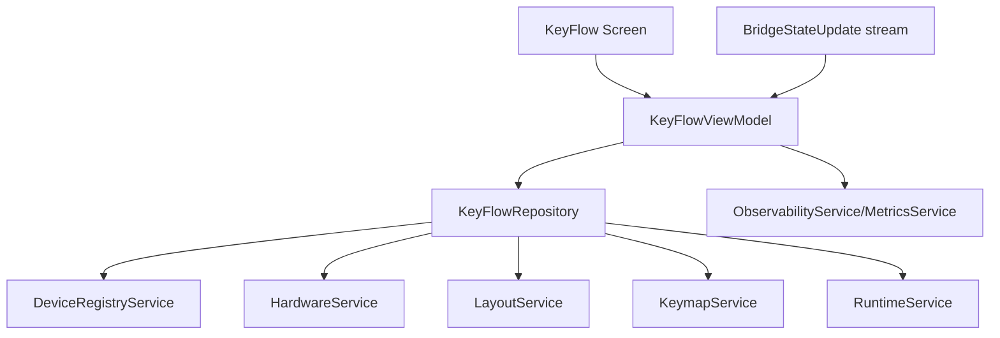

# Design Document

## Overview

KeyFlow Configuration Viewer makes the existing UI concept fully live: a read-only graph of devices → hardware profiles (wiring) → virtual layouts → keymaps/actions, enriched with runtime overlays and telemetry. It uses existing FFI-backed services (DeviceRegistryService, HardwareService, LayoutService, KeymapService, RuntimeService) to fetch real data, listens to bridge events for live updates, and exposes perf/health metrics through ObservabilityService/OTEL.

## Steering Document Alignment

### Technical Standards (tech.md)
- Follow hexagonal layering: widgets depend on view-models; view-models depend on services; services wrap FFI (KeyrxBridge).
- Dependency injection via ServiceRegistry; no direct DynamicLibrary usage in widgets.
- Error handling: fail fast with typed results, user-safe messages, and structured logs.
- Performance targets: keep UI responsive (≥55fps), avoid blocking UI thread on FFI; use Futures/isolates where needed.

### Project Structure (structure.md)
- UI additions live under `ui/lib/pages/` and `ui/lib/widgets/`; view models/adapters under `ui/lib/state/` or `ui/lib/services/facade/`.
- No cross-layer imports from widgets into services; reuse existing service contracts.

## Code Reuse Analysis
- **DeviceRegistryService / HardwareService / LayoutService / KeymapService / RuntimeService**: primary data sources for devices, wiring, layouts, keymaps, runtime state.
- **KeyrxBridge event callbacks**: already surface device connect/disconnect and state updates.
- **ServiceRegistry**: DI entry point for services; mirror pattern from wiring/mapping dashboards.
- **ObservabilityService / MetricsService**: capture OTEL metrics where enabled.
- **Visual components**: reuse `VirtualLayoutRenderer`, `VisualKeyboard`, wiring badges styles from wiring page as available.

### Existing Components to Leverage
- `ui/lib/widgets/virtual_layout_renderer.dart`: render keys and layouts.
- `ui/lib/pages/wiring.dart`: wiring data handling patterns and error states.
- `ui/lib/pages/mapping/mapping_dashboard.dart`: list-loading patterns with services.
- `ui/lib/services/device_registry_service.dart`: device stream and remap toggles.
- `ui/lib/services/runtime_service.dart`: runtime config and slots (for layer/active state).

### Integration Points
- **FFI**: Through existing services only. No new bridge methods initially; derive runtime overlays from BridgeStateUpdate stream.
- **Telemetry**: ObservabilityService/OTEL metrics for fetch latency, render timing, parse failures.
- **Autonomous Dev Hook**: Surface CLI-friendly status (success/failure counts, p95 fetch latency, stale runtime flag) consumable by the automation loop in `docs/AUTONOMOUS-DEV-GUIDE.md`.

### Iteration Speed Strategy
- **Hot reload loop**: Provide a `just keyflow:dev` (or script) that runs Flutter with a mock bridge and stub data, keeping FFI out of the UI loop for layout work.
- **Real-FFI loop**: Document a `just keyflow:ffi` that spins real bridge with minimal rebuilds; rely on sccache + incremental Rust builds and reuse generated bindings unless ABI changes.
- **Fast tests**: Add filtered “fast lane” commands (nextest/unit for Rust, widget/unit subset for Dart) and keep full suites for CI.
- **Reload-to-render telemetry**: Measure reload/render latency and log to ObservabilityService when enabled, without blocking UI.
- **No direct DynamicLibrary use**: Mock bridge is injected via ServiceRegistry to keep swaps trivial and hot-reload friendly.

## Architecture

- **View models**: `KeyFlowViewModel` orchestrates load/refresh; maintains:
  - devices (with remap status, freshness)
  - profiles + wiring maps
  - virtual layouts and keymaps/actions
  - runtime overlays (active layers/mods, recent events)
  - derived gaps/conflicts counts
- **Data adapters**: Map FFI/service models to lightweight view structs for rendering; isolate parsing/validation.
- **Event flow**:
  1) On screen mount: parallel fetch devices, profiles, layouts, keymaps; compute wiring completeness.
  2) Subscribe to device stream and bridge state updates; apply incremental mutations without full reload.
  3) Render via list + graph + details; highlight gaps/conflicts and runtime indicators.
- **Error handling**: per-pane inline errors; banner for bridge availability; stale-data indicator if runtime silent >5s.
- **Telemetry**: wrap fetches and render cycles with timers + success/failure counts.

### Modular Design Principles
- Single File Responsibility: separate view-model, repository/facade, widgets (list, graph, details, runtime overlay).
- Component Isolation: keep rendering stateless; state in view-model with ChangeNotifier/ValueNotifier.
- Service Layer Separation: services untouched; a thin facade composes multi-service reads.



## Components and Interfaces

### KeyFlowRepository (new, facade)
- **Purpose:** Aggregate data from services into cohesive DTOs for KeyFlow.
- **Interfaces:** `Future<KeyFlowSnapshot> loadAll()`, `Future<KeyFlowSnapshot> refreshDevices()`, `Stream<RuntimeOverlay> runtimeStream()`.
- **Dependencies:** DeviceRegistryService, HardwareService, LayoutService, KeymapService, RuntimeService.
- **Reuses:** Existing list/fetch methods; bridge event stream subscription.

### KeyFlowViewModel (new)
- **Purpose:** Manage UI state, trigger loads, react to events, expose derived stats (gaps/conflicts/staleness).
- **Interfaces:** `load()`, `refresh()`, `selectDevice(id)`, `selectKey(keyId)`, `dispose()`.
- **Dependencies:** KeyFlowRepository, ObservabilityService/MetricsService.
- **Reuses:** ChangeNotifier pattern used in other pages.

### UI Widgets
- **KeyFlowScreen**: scaffolds banner, list, graph, details, telemetry indicators.
- **DeviceListPane**: devices with remap status, last-refresh, error badges.
- **FlowGraphPane**: wiring visualization using VirtualLayoutRenderer + edge badges for missing/duplicate wiring.
- **DetailsPane**: selected virtual key actions/layers; runtime overlay indicators.
- **RuntimeStrip**: recent events + active layers/modifiers from runtime deltas.
- **Empty/Error States**: reusable banners consistent with wiring/mapping pages.

## Data Models

### KeyFlowSnapshot
```
devices: List<KeyFlowDevice>
profiles: Map<String, HardwareProfile>
layouts: Map<String, VirtualLayout>
keymaps: Map<String, Keymap>
runtime: RuntimeOverlay? (last)
generatedAt: DateTime
errors: List<KeyFlowError>
```

### KeyFlowDevice
```
id: String (device key)
displayName: String
remapEnabled: bool
profileId: String?
wiring: Map<int, String> // physical -> virtual id
layoutId: String?
gaps: int
conflicts: int
```

### RuntimeOverlay
```
activeLayers: List<String>
activeModifiers: List<String>
recentEvents: List<RuntimeEvent>
isBypassed: bool
lastUpdate: DateTime
```

## Error Handling

### Error Scenarios
1. **Bridge unavailable or protocol mismatch**
   - **Handling:** Show banner with retry; fall back to cached snapshot if any.
   - **User Impact:** Read-only view with freshness warning.
2. **Partial data failures (e.g., layouts fetch fails)**
   - **Handling:** Render available panes; inline error for failed pane; telemetry logged.
   - **User Impact:** Can inspect other data; knows which part failed.
3. **Runtime stream stalls >5s**
   - **Handling:** Show “runtime paused” badge and manual refresh; keep last overlay.
   - **User Impact:** Understands live data is stale; can retry.
4. **Schema/parse mismatch from FFI**
   - **Handling:** Capture structured error (operation, payload size), surface user-safe message, drop bad payload.
   - **User Impact:** Viewer stays up; missing data called out.

## Testing Strategy

### Unit Testing
- View-model logic: wiring gap/conflict computation, staleness timers, selection behavior.
- Repository: data aggregation and error propagation with mocked services.

### Integration Testing
- Widget tests with mocked services to verify banners, empty/error states, and render of wiring/graph panes.
- Event handling: simulate device stream updates and runtime deltas to confirm UI updates without full reload.

### End-to-End Testing
- Happy path: bridge available, devices+profiles+layouts present; verify wiring badges and runtime overlay.
- Failure path: bridge unavailable -> banner + cached snapshot; partial fetch failure -> inline pane error.
