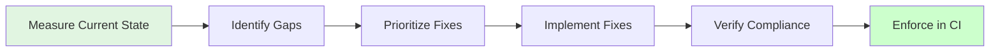

# Design Document

## Overview

This design addresses remaining code quality items: function length compliance, test coverage improvements, structured logging verification, and documentation coverage. Each improvement follows analyze → verify → fix pattern.

**Core Principles:**
1. **Measure first** - Understand current state
2. **Prioritize impact** - Focus on critical gaps
3. **Minimal changes** - Only fix what needs fixing
4. **Verify compliance** - Ensure standards met

## Steering Document Alignment

### Technical Standards (~/.claude/CLAUDE.md)

**Code Metrics Met:**
- ✅ **Max 50 lines/function**: Verified and enforced
- ✅ **80% test coverage**: Overall minimum achieved
- ✅ **90% critical paths**: Services/API/engine/FFI covered
- ✅ **Structured logging**: JSON with required fields

## Architecture

### Analysis and Fix Pipeline



## Component Designs

### 1. Function Length Analysis

**Tool Design:**
```rust
// Custom analysis script
fn analyze_function_lengths() -> Vec<FunctionInfo> {
    // Parse Rust files
    // Identify function boundaries
    // Count non-comment/blank lines
    // Report violations
}
```

**Detection Strategy:**
- Use `syn` crate to parse Rust AST
- Count lines between `fn` and closing `}`
- Exclude comments and blank lines
- Report functions >50 lines

**Refactoring Pattern:**
```rust
// Before: 80-line function
pub fn complex_operation(data: Data) -> Result<Output> {
    // 80 lines of logic
}

// After: Broken into helpers
pub fn complex_operation(data: Data) -> Result<Output> {
    let validated = validate_input(data)?;
    let processed = process_data(validated)?;
    let result = finalize_output(processed)?;
    Ok(result)
}

fn validate_input(data: Data) -> Result<ValidatedData> {
    // 15-20 lines
}

fn process_data(data: ValidatedData) -> Result<ProcessedData> {
    // 20-30 lines
}

fn finalize_output(data: ProcessedData) -> Result<Output> {
    // 15-20 lines
}
```

**Refactoring Guidelines:**
- Extract logical steps into helpers
- Name helpers descriptively
- Keep public API unchanged
- Preserve all behavior
- Maintain error handling
- Update tests if needed (usually not)

---

### 2. Test Coverage Improvements

**Coverage Analysis:**
```bash
cargo llvm-cov --lib --html
# Review HTML report
# Identify uncovered lines/branches
```

**Gap Prioritization:**
```
Priority 1: Critical paths <90% (services, API, engine, FFI)
Priority 2: Overall <80% (all other code)
Priority 3: Nice-to-have (edge cases, error paths)
```

**Test Addition Strategy:**

**For uncovered logic:**
```rust
// Identify uncovered lines in coverage report
// Red/yellow highlighted lines

// Add targeted test
#[test]
fn test_uncovered_error_path() {
    // Set up conditions that hit uncovered lines
    // Verify behavior
}
```

**For uncovered branches:**
```rust
// If-else, match arms not covered

#[test]
fn test_branch_a() {
    // Test first branch
}

#[test]
fn test_branch_b() {
    // Test second branch
}
```

**Test Quality Criteria:**
- Test real scenarios, not just coverage
- Use mocks from DI spec for unit tests
- Test error paths and edge cases
- Verify behavior, not implementation
- Keep tests maintainable

---

### 3. Structured Logging Verification

**Current State Check:**
```rust
// Verify LogEntry struct has required fields
pub struct LogEntry {
    pub timestamp: u64,      // ✓ Required
    pub level: LogLevel,     // ✓ Required
    pub target: String,      // service field
    pub message: String,     // event field
    pub fields: HashMap<String, String>,  // context
}
```

**Verification Steps:**
1. Review `observability/entry.rs` - Check LogEntry struct
2. Review `observability/logger.rs` - Check JSON serialization
3. Sample logs in tests - Verify format
4. Check for PII/secrets - Ensure not logged

**Format Validation:**
```rust
#[test]
fn test_log_format_compliance() {
    // Capture log output
    let log = capture_log();

    // Parse as JSON
    let entry: serde_json::Value = serde_json::from_str(&log).unwrap();

    // Verify required fields
    assert!(entry.get("timestamp").is_some());
    assert!(entry.get("level").is_some());
    assert!(entry.get("service").is_some() || entry.get("target").is_some());
    assert!(entry.get("event").is_some() || entry.get("message").is_some());
}
```

**Fixes if Needed:**
- Add missing fields to LogEntry
- Update serialization to include all fields
- Add field mapping (target → service, message → event)
- Ensure timestamp is ISO 8601 format

---

### 4. Documentation Coverage

**Analysis Tool:**
```bash
# Built-in cargo tool
cargo doc --no-deps 2>&1 | grep -i warning
```

**Missing Doc Detection:**
```bash
# Custom script or manual review
rg "^pub (fn|struct|trait|enum)" --no-heading | \
  while read line; do
    # Check if next line is doc comment
  done
```

**Documentation Template:**
```rust
/// Brief description of what this does.
///
/// More detailed explanation if needed.
///
/// # Parameters
/// * `param1` - Description of param1
/// * `param2` - Description of param2
///
/// # Returns
/// Description of return value
///
/// # Errors
/// When this can error and why
///
/// # Examples
/// ```
/// let result = function(arg1, arg2);
/// ```
pub fn function(param1: Type1, param2: Type2) -> Result<Output> {
    // ...
}
```

**Quick Wins:**
- Functions missing docs entirely
- Types without descriptions
- Unclear parameter purposes
- Missing examples for complex APIs

---

### 5. Code Complexity Analysis

**Tool:** `cargo-geiger` or custom complexity calculator

**Cyclomatic Complexity:**
```
CC = edges - nodes + 2 (control flow graph)

Simplified:
- Base: 1
- Each if/while/for: +1
- Each match arm: +1
- Each &&/||: +1
```

**Example Analysis:**
```rust
// Complexity = 8 (moderate)
pub fn calculate(value: i32, mode: Mode) -> Result<i32> {  // 1
    if value < 0 {  // +1 = 2
        return Err(Error::Negative);
    }

    let result = match mode {  // +3 = 5
        Mode::Add => value + 10,
        Mode::Multiply => value * 2,
        Mode::Custom(x) => value + x,
    };

    if result > 1000 {  // +1 = 6
        Err(Error::Overflow)
    } else if result < -1000 {  // +1 = 7
        Err(Error::Underflow)
    } else {
        Ok(result)  // +1 (else) = 8
    }
}
```

**Simplification Strategies:**
- Extract nested conditions
- Use early returns
- Replace complex match with method dispatch
- Split into multiple functions

## Testing Strategy

### Per-Improvement Testing

**After function refactoring:**
```bash
cargo test --lib              # All tests pass
cargo bench <function_name>   # Performance unchanged
```

**After adding tests:**
```bash
cargo test <new_test>         # New test passes
cargo llvm-cov --lib          # Coverage improved
```

**After logging fixes:**
```bash
cargo test observability      # Logging tests pass
# Manual: Check log output format
```

**After documentation:**
```bash
cargo doc --no-deps           # No warnings
```

## Implementation Plan

### Phase 1: Analysis (Measure Current State)

1. **Function Length Audit**
   - Write/run analysis script
   - Identify all functions >50 lines
   - Rank by severity

2. **Coverage Measurement**
   - Run `cargo llvm-cov --lib --html`
   - Identify gaps <80% overall
   - Identify critical paths <90%

3. **Logging Verification**
   - Review LogEntry structure
   - Verify JSON output format
   - Check for PII/secrets

4. **Documentation Audit**
   - Run `cargo doc` and check warnings
   - Identify undocumented public APIs
   - Prioritize by importance

5. **Complexity Analysis** (Optional)
   - Calculate cyclomatic complexity
   - Identify functions >10 complexity
   - Prioritize simplification

### Phase 2: Prioritization

**High Priority:**
- Critical path coverage gaps (<90%)
- Functions >100 lines (very long)
- Missing docs on core APIs
- Logging format violations

**Medium Priority:**
- Overall coverage gaps (<80%)
- Functions 70-100 lines
- Missing docs on public utilities
- Complexity >15

**Low Priority:**
- Functions 50-70 lines (borderline)
- Nice-to-have documentation
- Complexity 10-15 (moderate)

### Phase 3: Implementation

Work through prioritized list:
- Fix high priority items first
- Test after each fix
- Measure improvement
- Move to next item

### Phase 4: Enforcement

Add CI checks:
```yaml
# .github/workflows/quality.yml
- name: Check function length
  run: ./scripts/check_function_length.sh

- name: Check coverage
  run: cargo llvm-cov --lib --summary-only | tee coverage.txt
  # Parse and verify ≥80%

- name: Check docs
  run: cargo doc --no-deps
```

## Backward Compatibility

**Zero Breaking Changes:**
- Refactoring maintains exact behavior
- New tests don't change existing APIs
- Documentation is additive
- Logging format improvements backward compatible

## Performance Considerations

**Test Runtime:**
- New tests should be fast (<1ms unit tests)
- Coverage measurement adds ~5-10s to CI

**Build Time:**
- Function refactoring: no impact
- Documentation: negligible impact
