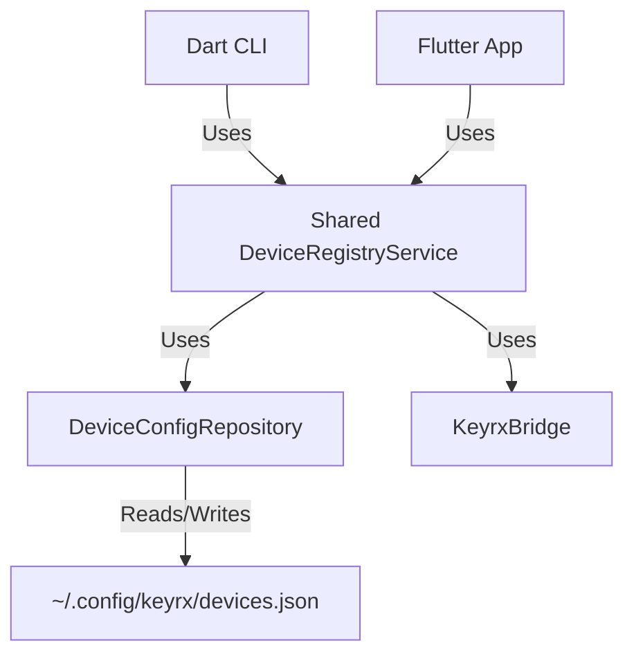

# Design Document

## Overview

The `DeviceRegistryService` will be moved from `ui/lib/services` to `packages/core_logic/lib/services`. It will switch from `SharedPreferences` (Flutter-specific) to `dart:io` JSON file storage. This ensures that both the Flutter UI and the Dart CLI can access and modify the same device configuration (Virtual Devices, User Labels).

## Steering Document Alignment

### Technical Standards (tech.md)
Adheres to the "Headless Dart Harness Strategy" by centralizing logic in `core_logic`. Uses `Freezed` models for serialization.

### Project Structure (structure.md)
- `packages/core_logic/lib/services/`: New location for the shared service.
- `packages/core_logic/lib/repositories/`: New location for the JSON file repository.

## Architecture



## Components and Interfaces

### DeviceConfigRepository
- **Purpose:** Persist device metadata (virtual devices list, user labels) to a JSON file.
- **Location:** `packages/core_logic/lib/repositories/device_config_repository.dart`
- **Interface:**
  - `Future<DeviceConfig> load()`
  - `Future<void> save(DeviceConfig config)`

### Shared DeviceRegistryService
- **Purpose:** Business logic for merging FFI devices with persistent config.
- **Location:** `packages/core_logic/lib/services/device_registry_service.dart`
- **Dependencies:** `KeyrxBridge`, `DeviceConfigRepository`.

## Data Models

### DeviceConfig
```dart
@freezed
class DeviceConfig with _$DeviceConfig {
  const factory DeviceConfig({
    @Default([]) List<DeviceIdentity> virtualDevices,
    // We can store labels directly on the identity or separate map
    // For simplicity, we reuse DeviceIdentity which already has userLabel
  }) = _DeviceConfig;
}
```

## Error Handling

### File Access
- **Scenario:** Config file is locked or unwritable.
- **Handling:** Log error, fallback to in-memory defaults. CLI/UI should continue to function with FFI devices only.

## Testing Strategy

### Unit Testing
- Test `DeviceConfigRepository` with a temporary file.
- Test `DeviceRegistryService` with mock Bridge and Repository.

### Integration Testing
- Use the CLI to add a virtual device, then verify the JSON file content.
