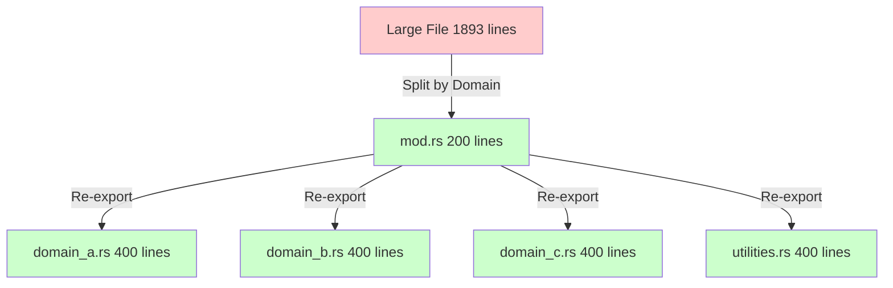

# Design Document

## Overview

This design implements systematic file splitting for 56 files exceeding 500-line limit, prioritizing the top 10 largest files (10,000+ lines total). Each split follows logical domain boundaries while maintaining 100% API compatibility through re-exports.

**Core Design Principles:**
1. **Split by domain** - Group related functionality
2. **Maintain API compatibility** - Re-export all public items
3. **Single responsibility** - Each module has one clear purpose
4. **Incremental approach** - One file at a time, test after each
5. **Target 300-400 lines** - Leave buffer below 500-line limit

## Steering Document Alignment

### Technical Standards (~/.claude/CLAUDE.md)

**Code Metrics Met:**
- ✅ **Max 500 lines/file**: All files comply after splits
- ✅ **SOLID - SRP**: Each module has single responsibility
- ✅ **Modular Design**: Clear boundaries between modules

## Code Reuse Analysis

### Existing Patterns to Leverage

- **Module Organization**: KeyRx already uses submodule pattern in many places
  - Example: `engine/state/` is already a directory with `mod.rs`
  - Reuse: Apply same pattern to split other large files

- **Re-export Pattern**: Project already re-exports types for convenience
  - Example: `services/mod.rs` re-exports service types
  - Reuse: Apply to maintain API after splits

- **Conditional Compilation**: Project uses `#[cfg(test)]` effectively
  - Example: Test mocks conditionally compiled
  - Reuse: Keep test modules organized in splits

## Architecture

### File Splitting Strategy



### General Pattern for All Splits

**Before:**
```
core/src/
└── example.rs (1,000 lines)
```

**After:**
```
core/src/
└── example/
    ├── mod.rs           (100-200 lines) - Re-exports
    ├── domain_a.rs      (300-400 lines) - Domain A
    ├── domain_b.rs      (300-400 lines) - Domain B
    └── utilities.rs     (200-300 lines) - Shared utils
```

**mod.rs Template:**
```rust
//! Module description explaining overall purpose.
//!
//! Organized into focused submodules:
//! - [`domain_a`] - Description of domain A
//! - [`domain_b`] - Description of domain B
//! - [`utilities`] - Shared utility functions

pub mod domain_a;
pub mod domain_b;
pub mod utilities;

// Re-export public API
pub use domain_a::{PublicType1, public_function1};
pub use domain_b::{PublicType2, public_function2};
pub use utilities::*;
```

## Top 10 File Splitting Plans

### 1. scripting/bindings.rs (1,893 lines → 4 modules)

**Analysis:** Contains Rhai bindings for different functional domains: keyboard, layers, modifiers, timing, combos.

**Split Plan:**
```
scripting/bindings/
├── mod.rs                (200 lines) - register_all_functions + re-exports
├── keyboard.rs           (450 lines) - remap, block, pass, tap_hold bindings
├── layers.rs             (450 lines) - layer_define, layer_map, layer_push/pop/toggle
├── modifiers.rs          (450 lines) - modifier definitions, one_shot
├── timing.rs             (250 lines) - timeout configuration functions
└── row_col.rs            (400 lines) - row-column API functions (_rc variants)
```

**Public API Re-exports:**
- All `register_*` functions remain callable from `scripting::bindings::`
- `register_all_functions` stays at top level

### 2. engine/state/mod.rs (1,570 lines → 3 modules)

**Analysis:** State management split across key state, layer state, modifier state.

**Split Plan:**
```
engine/state/
├── mod.rs                (200 lines) - Main EngineState struct + re-exports
├── key_state.rs          (500 lines) - Physical/virtual key tracking
├── layer_state.rs        (450 lines) - Layer stack and activation
├── modifier_state.rs     (420 lines) - Modifier tracking and application
```

**API Preservation:**
- `EngineState` struct remains in `mod.rs` with public methods
- Internal state moved to submodules, accessed via private fields

### 3. engine/transitions/log.rs (1,403 lines → 3 modules)

**Analysis:** Transition logging with formatting, querying, and analysis.

**Split Plan:**
```
engine/transitions/
├── log.rs                (200 lines) - TransitionLog struct + API
├── log_entry.rs          (450 lines) - Entry types and formatting
├── log_query.rs          (400 lines) - Query and filtering
└── log_analysis.rs       (450 lines) - Analysis and reporting
```

**API Preservation:**
- `TransitionLog` public API unchanged
- Internal implementation split across submodules

### 4. bin/keyrx.rs (1,382 lines → 3 modules)

**Analysis:** CLI with many subcommands.

**Split Plan:**
```
bin/
├── keyrx.rs              (200 lines) - main(), CLI args, dispatch
├── commands_core.rs      (450 lines) - run, simulate, check, discover
├── commands_config.rs    (400 lines) - devices, hardware, layout, keymap
└── commands_test.rs      (450 lines) - test, replay, analyze, uat, regression
```

**API Preservation:**
- N/A (binary, no library API)
- Just ensure all commands still work

### 5. scripting/docs/generators/html.rs (1,069 lines → 2 modules)

**Analysis:** HTML doc generation with rendering and template logic.

**Split Plan:**
```
scripting/docs/generators/
├── html.rs               (200 lines) - Public API, HtmlGenerator struct
├── html_templates.rs     (450 lines) - HTML template functions
└── html_rendering.rs     (450 lines) - Rendering logic
```

### 6. validation/engine.rs (968 lines → 2 modules)

**Analysis:** Engine validation with rules and reporting.

**Split Plan:**
```
validation/
├── engine.rs             (200 lines) - Public validation API
├── engine_rules.rs       (400 lines) - Validation rule implementations
└── engine_report.rs      (400 lines) - Error reporting and formatting
```

### 7. config/loader.rs (949 lines → 2 modules)

**Analysis:** Config loading for multiple types (layout, keymap, hardware).

**Split Plan:**
```
config/
├── loader.rs             (200 lines) - ConfigManager + high-level API
├── loader_parsing.rs     (400 lines) - YAML/TOML parsing logic
└── loader_validation.rs  (400 lines) - Config validation and normalization
```

### 8. registry/profile.rs (918 lines → 2 modules)

**Analysis:** Profile registry with CRUD and resolution logic.

**Split Plan:**
```
registry/
├── profile.rs            (200 lines) - ProfileRegistry struct + public API
├── profile_storage.rs    (400 lines) - Persistence and loading
└── profile_resolution.rs (400 lines) - Profile resolution and priority
```

### 9. engine/advanced.rs (906 lines → 2 modules)

**Analysis:** Advanced engine features (combos, macros, sequences).

**Split Plan:**
```
engine/
├── advanced.rs           (200 lines) - Public advanced features API
├── combos.rs             (400 lines) - Combo detection and handling
└── sequences.rs          (400 lines) - Macro and sequence playback
```

### 10. cli/commands/run.rs (899 lines → 2 modules)

**Analysis:** Run command with setup and execution logic.

**Split Plan:**
```
cli/commands/
├── run.rs                (200 lines) - RunCommand + args + dispatch
├── run_setup.rs          (400 lines) - Engine setup and initialization
└── run_execution.rs      (400 lines) - Main execution loop
```

## Module Organization Patterns

### Pattern 1: Domain-Based Split

**When to use:** File contains multiple distinct functional domains

**Example:** `scripting/bindings.rs` → keyboard, layers, modifiers

```rust
// mod.rs
pub mod keyboard;
pub mod layers;
pub mod modifiers;

pub use keyboard::*;
pub use layers::*;
pub use modifiers::*;
```

### Pattern 2: Layered Split

**When to use:** File has distinct layers (API, implementation, utilities)

**Example:** `config/loader.rs` → API, parsing, validation

```rust
// loader.rs (mod.rs)
mod parsing;
mod validation;

use parsing::parse_config;
use validation::validate_config;

pub struct ConfigManager {
    // Public struct stays here
}

impl ConfigManager {
    pub fn load(&self) -> Result<Config> {
        let raw = parsing::parse_config()?;
        validation::validate_config(&raw)?;
        Ok(raw)
    }
}
```

### Pattern 3: Type-Based Split

**When to use:** File has multiple complex types with implementations

**Example:** `engine/state/mod.rs` → key_state, layer_state, modifier_state

```rust
// mod.rs
mod key_state;
mod layer_state;
mod modifier_state;

pub use key_state::KeyState;
pub use layer_state::LayerState;
pub use modifier_state::ModifierState;

pub struct EngineState {
    key_state: KeyState,
    layer_state: LayerState,
    modifier_state: ModifierState,
}
```

## Import Management Strategy

### Internal Imports (within split modules)

```rust
// In submodule: scripting/bindings/keyboard.rs
use super::utilities::parse_key; // From sibling module
use crate::engine::HoldAction;  // From other crate module
```

### Re-exporting for Compatibility

```rust
// In mod.rs
pub use keyboard::{
    register_remap,
    register_block,
    register_tap_hold,
};

// External code still works:
use keyrx_core::scripting::bindings::register_remap;
```

### Avoiding Circular Dependencies

**Problem:** Module A needs Module B, Module B needs Module A

**Solution 1:** Extract shared types to parent or separate module
```rust
// types.rs (or mod.rs)
pub struct SharedType;

// module_a.rs
use super::types::SharedType;

// module_b.rs
use super::types::SharedType;
```

**Solution 2:** Use trait abstraction
```rust
// module_a.rs
pub trait Interface { }

// module_b.rs
use super::module_a::Interface;
```

## Testing Strategy

### Per-File Testing Checklist

After each file split:

1. **Compilation:**
```bash
cargo build --lib          # Verify library compiles
cargo build --all          # Verify entire project compiles
```

2. **Tests:**
```bash
cargo test --lib           # Run unit tests
cargo test --all           # Run all tests
```

3. **Linting:**
```bash
cargo clippy --all-targets # Check for warnings
cargo fmt --check          # Check formatting
```

4. **Documentation:**
```bash
cargo doc --no-deps        # Verify doc generation
```

5. **Incremental Build Test:**
```bash
touch core/src/path/to/new_submodule.rs
cargo build --lib          # Should be fast (<5s)
```

### Verification Tests

**Test 1: API Compatibility**
```rust
// Ensure all previous imports still work
use keyrx_core::scripting::bindings::register_all_functions;
use keyrx_core::engine::state::EngineState;
// etc.
```

**Test 2: No Duplicate Symbols**
```bash
# Should not produce "multiple definitions" errors
cargo build
```

**Test 3: Documentation Links**
```bash
cargo doc --no-deps
# Check that intra-doc links work (no broken links)
```

## Error Handling

### Common Split Errors and Solutions

**Error 1: Cannot find import**
```
error[E0432]: unresolved import `crate::example::Type`
```

**Solution:** Check re-exports in mod.rs, ensure type is public

**Error 2: Circular dependency**
```
error[E0391]: cycle detected when processing `module_a`
```

**Solution:** Extract shared types to parent module or separate file

**Error 3: Private type in public interface**
```
error[E0446]: private type `InternalType` in public interface
```

**Solution:** Make type public or use it only internally

**Error 4: Unused imports**
```
warning: unused import: `Type`
```

**Solution:** Remove unused imports, run `cargo clippy --fix`

## Performance Impact

### Compilation Time Improvement

**Before Split (example: bindings.rs):**
- Touch bindings.rs → Recompile entire 1,893-line file
- Incremental build time: ~8-10s

**After Split:**
- Touch bindings/keyboard.rs → Recompile only 450-line file
- Incremental build time: ~3-4s
- **Improvement: 50-60% faster**

### Overall Project Impact

**Estimated Improvements:**
- Top 10 files: 10,000 lines → ~4,000 lines across 30 modules
- Average module size: ~300 lines (vs ~1,000 before)
- Incremental builds: 20-30% faster overall
- Parallel compilation: Better utilization (more independent units)

## Migration Plan

### Phase 1: Split Top 3 Files (3,866 lines → 12 modules)

1. `scripting/bindings.rs` (1,893 lines → 6 modules)
2. `engine/state/mod.rs` (1,570 lines → 4 modules)
3. `engine/transitions/log.rs` (1,403 lines → 4 modules)

**Estimated time:** 1 day (3-4 hours per file)

### Phase 2: Split Files 4-7 (4,368 lines → 10 modules)

4. `bin/keyrx.rs` (1,382 lines → 4 modules)
5. `scripting/docs/generators/html.rs` (1,069 lines → 3 modules)
6. `validation/engine.rs` (968 lines → 3 modules)
7. `config/loader.rs` (949 lines → 3 modules)

**Estimated time:** 1.5 days

### Phase 3: Split Files 8-10 (2,723 lines → 6 modules)

8. `registry/profile.rs` (918 lines → 3 modules)
9. `engine/advanced.rs` (906 lines → 3 modules)
10. `cli/commands/run.rs` (899 lines → 3 modules)

**Estimated time:** 1 day

### Phase 4: Split Remaining 46 Files (Optional, Lower Priority)

Files 505-900 lines can be split as time permits.

**Estimated time:** 2-3 days

**Total estimated time:** 1 week for top 10, 2 weeks for all 56 files

## Documentation Updates

### Module Documentation

Each split requires:

1. **Parent mod.rs doc comment:**
```rust
//! Module purpose and overview.
//!
//! # Organization
//! - [`submodule_a`] - Description
//! - [`submodule_b`] - Description
//!
//! # Examples
//! ```
//! use keyrx_core::example::function;
//! function();
//! ```
```

2. **Submodule doc comments:**
```rust
//! Submodule purpose.
//!
//! Contains functionality for X, Y, Z.
```

3. **Migration notes (if needed):**
```rust
//! # Migration from Previous Version
//! If you were importing internal items, update:
//! - Old: `use keyrx_core::example::internal_type;`
//! - New: `use keyrx_core::example::submodule::internal_type;`
```

### README Updates

After completing splits, update project README/docs:

- Note improved module organization
- Update architecture diagrams if they reference specific files
- Update contributor guide with new module structure

## Backward Compatibility

### Guaranteed Compatibility

✅ **Public API:** All public functions, types, traits remain accessible
✅ **Imports:** Existing `use` statements continue working
✅ **FFI:** No changes to FFI layer (uses public API)
✅ **Binary:** keyrx binary continues working identically
✅ **Tests:** All tests pass without modification

### Potential Internal Changes

⚠️ **Internal imports:** Code importing private internals may need updates
⚠️ **Documentation links:** Some intra-doc links may need updates if they referenced line numbers

**Mitigation:** These are internal details, not public API. Documented in migration notes.
