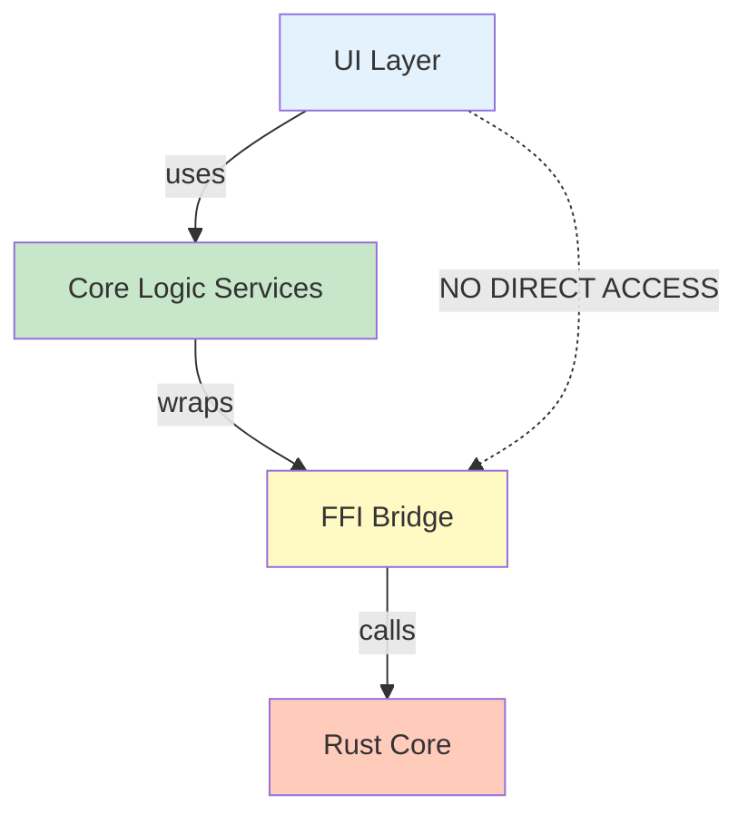

# Design Document

## Overview

This design addresses 37 remaining SSOT violations by consolidating duplicate classes, migrating business logic from UI to core_logic, and resolving interface inconsistencies. The refactoring maintains existing functionality while establishing clear architectural boundaries.

## Steering Document Alignment

### Technical Standards (tech.md)
- Follows SOLID principles with Single Responsibility
- Maintains dependency injection patterns
- Preserves structured logging and error handling
- Ensures no Flutter dependencies in core_logic

### Project Structure (structure.md)
- Respects ui/ and packages/core_logic/ separation
- Places business logic in core_logic/lib/services/
- Keeps UI adapters in ui/lib/services/
- Maintains existing file organization conventions

## Code Reuse Analysis

### Existing Components to Leverage
- **core_logic/lib/models/log_entry.dart**: Base LogEntry class for FFI logs
- **core_logic/lib/services/device_registry_service.dart**: Core device registry implementation
- **core_logic/lib/ffi/bridge.dart**: FFI bridge interface for native calls
- **ui/lib/services/service_registry.dart**: DI container for service registration

### Integration Points
- **Service Registry**: Update UI service registrations to use core_logic services
- **Provider Setup**: Modify Riverpod providers to inject core_logic services
- **FFI Bridge**: Ensure all FFI calls go through core_logic service layer

## Architecture

### Layer Separation Strategy



### Modular Design Principles
- **Single File Responsibility**: Each service handles one domain (devices, metrics, observability, etc.)
- **Service Layer Separation**: UI → Service Interface → Service Implementation → FFI
- **Adapter Pattern**: UI-specific wrappers clearly named (e.g., `UIDeviceRegistry`)
- **Dependency Injection**: Services injected via constructor, not global access

## Components and Interfaces

### Component 1: Unified LogEntry

**Current State:**
- UI: `ui/lib/services/observability_service.dart` - LogEntry with timestamp:int, level:LogLevel enum
- Core: `packages/core_logic/lib/models/log_entry.dart` - LogEntry with timestamp:DateTime, level:String

**Design Decision:** Keep both, rename UI version to `ObservabilityLogEntry` to clarify it's for UI observability display

**Purpose:** Separate concerns - core LogEntry for FFI serialization, UI LogEntry for formatted display
**Interfaces:**
- Core LogEntry: Simple data class for FFI deserialization
- UI ObservabilityLogEntry: Rich model with datetime formatting, level parsing
**Dependencies:** UI version can convert from core version if needed
**Reuses:** Existing core_logic log_entry.dart unchanged

### Component 2: Device Registry Service Consolidation

**Current State:**
- UI: `ui/lib/services/device_registry_service.dart` - Wrapper with UI-specific result types
- Core: `packages/core_logic/lib/services/device_registry_service.dart` - Full implementation

**Design Decision:** Rename UI version to `UIDeviceRegistryAdapter` to clarify its role as an adapter

**Purpose:** Provide UI-friendly API while delegating to core implementation
**Interfaces:**
- Core DeviceRegistryService: Full interface with DeviceRegistryResult<T>
- UI UIDeviceRegistryAdapter: Simplified interface with DeviceRegistryOperationResult
**Dependencies:** UI adapter depends on core service
**Reuses:** Delegates all operations to core_logic service

### Component 3: Business Logic Migration

**Current State:** 32 violations across multiple files with direct FFI usage

**Files Requiring Changes:**
1. `ui/lib/state/device_stream_provider.dart` - Direct FFI for device streams
2. `ui/lib/state/providers_setup.dart` - Direct FFI for multiple services (5 violations)
3. `ui/lib/repositories/keyflow_repository.dart` - Direct FFI for keyflow operations (2 violations)
4. `ui/lib/services/flow_validator.dart` - Business logic (validator class)
5. `ui/lib/services/metrics_service.dart` - Direct FFI for metrics (2 violations)
6. `ui/lib/services/mapping_validator.dart` - Business logic (validator class)
7. `ui/lib/services/benchmark_service.dart` - Direct FFI for benchmarks (2 violations)
8. `ui/lib/services/observability_service.dart` - Direct FFI for logs

**Design Decision:** Create or use existing core_logic services for each domain

**Service Mapping:**
- Device operations → `core_logic/services/device_service.dart` (create if missing)
- Keyflow operations → `core_logic/services/keyflow_service.dart` (create if missing)
- Metrics operations → `core_logic/services/metrics_service.dart` (create if missing)
- Observability logs → `core_logic/services/observability_service.dart` (create if missing)
- Validators → Keep in UI with clear naming (FlowValidator, MappingValidator are UI-specific)

**Purpose:** Isolate FFI calls in core services, make UI layer pure Dart
**Interfaces:** Each service exposes clean async API without exposing FFI details
**Dependencies:** UI services depend on core services via DI
**Reuses:** Existing bridge patterns from core_logic

### Component 4: Interface Consistency Fixes

**Current State:** 2 interface inconsistency violations (details TBD from checker output)

**Design Decision:** Align method signatures between FFI and web implementations

**Purpose:** Ensure services are properly polymorphic
**Interfaces:** Shared interface class with @override annotations
**Dependencies:** Both implementations depend on shared interface
**Reuses:** Existing conditional export patterns (`if (dart.library.html)`)

## Data Models

### ObservabilityLogEntry (UI)
```dart
class ObservabilityLogEntry {
  final int timestamp;           // milliseconds since epoch
  final LogLevel level;          // enum: trace, debug, info, warn, error
  final String target;
  final String message;
  final Map<String, String> fields;
  final String? span;

  DateTime get dateTime;         // computed property
  static LogLevel _parseLogLevel(String);
  factory ObservabilityLogEntry.fromJson(Map<String, dynamic>);
}
```

### UIDeviceRegistryAdapter
```dart
class UIDeviceRegistryAdapter {
  final DeviceRegistryService _coreService;

  Future<List<DeviceState>> getDevices();
  Future<void> addVirtualDevice(DeviceIdentity);
  Future<void> removeVirtualDevice(String key);
  // ... delegates to _coreService
}
```

## Error Handling

### Error Scenarios

1. **FFI Bridge Errors**
   - **Handling:** Core services catch FFI exceptions, wrap in Result<T> types
   - **User Impact:** UI shows friendly error message from Result.errorMessage

2. **Service Migration Breakage**
   - **Handling:** Gradual migration with feature flags if needed
   - **User Impact:** No user-visible changes during migration

3. **Interface Signature Mismatches**
   - **Handling:** Adapter methods bridge signature differences
   - **User Impact:** Transparent to users

## Testing Strategy

### Unit Testing
- Test core services in isolation with mocked FFI bridge
- Test UI adapters with mocked core services
- Verify error handling in service layer

### Integration Testing
- Test UI → Core Service → FFI flow end-to-end
- Verify dependency injection wiring
- Test platform-specific implementations (FFI vs Web)

### End-to-End Testing
- Verify existing UI functionality unchanged
- Test device operations through UI
- Validate real-time updates still work

## Migration Strategy

### Phase 1: Duplicate Class Renames
1. Rename UI LogEntry → ObservabilityLogEntry
2. Rename UI DeviceRegistryService → UIDeviceRegistryAdapter
3. Update all references
4. Verify compilation

### Phase 2: Core Service Creation
1. Create missing core services (DeviceService, MetricsService, etc.)
2. Move FFI logic from UI to core services
3. Add service interfaces for DI
4. Write unit tests for core services

### Phase 3: UI Migration
1. Update UI components to use core services via DI
2. Remove direct FFI imports from UI
3. Update service registry with new services
4. Verify integration tests pass

### Phase 4: Interface Fixes
1. Identify signature mismatches
2. Create shared interface
3. Align implementations
4. Test polymorphism

## Success Criteria

- SSOT checker reports 0 violations (down from 37)
- All existing tests pass
- No user-visible functionality changes
- flutter analyze reports 0 errors
- Clear architectural boundaries maintained
