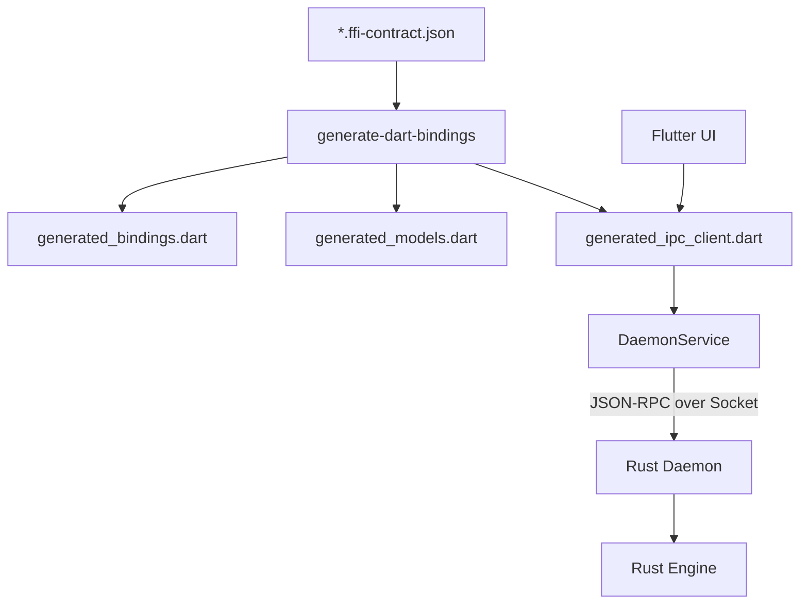

# Design Document: Unified FFI/IPC Codegen

## Overview

This feature extends the `generate-dart-bindings` tool to support the generation of type-safe Dart IPC clients from `.ffi-contract.json` files. This ensures that the communication between the Flutter UI and the `keyrx daemon` follows the same strict contracts as the FFI layer, providing a Single Source of Truth (SSOT) and preventing protocol drift.

## Steering Document Alignment

### Technical Standards (tech.md)
- Follows the established pattern of contract-driven development.
- Reuses the existing Rust-based code generation infrastructure.
- Adheres to the JSON-RPC 2.0 protocol standards used by the daemon.

### Project Structure (structure.md)
- Maintains the separation between "Core" (Rust) and "UI" (Flutter).
- Places generated IPC clients in `ui/lib/services/generated/` to keep them separate from manual service logic.

## Code Reuse Analysis

### Existing Components to Leverage
- **`models_gen.rs`**: Already generates Dart data classes from contracts. We will reuse these for IPC method parameters and return types.
- **`loader.rs`**: Handles loading and parsing of `.ffi-contract.json` files.
- **`DaemonService`**: The existing manual `DaemonService` will be refactored to serve as the generic transport layer, which the generated clients will depend on.

### Integration Points
- **`generate-dart-bindings` Crate**: We will add a new `ipc_client_gen.rs` module and wire it into the `pipeline.rs`.
- **`DaemonService`**: Generated clients will take a `DaemonService` instance and use its `sendRequest` and `events` stream.

## Architecture

The system follows a layered architecture where the communication protocol is abstracted away from the domain logic.



### Components and Interfaces

#### 1. `IpcClientGenerator` (Rust)
- **Purpose:** Generates Dart classes that provide a typed interface to the Daemon.
- **Input:** `FfiContract` object.
- **Output:** Dart code string containing `DomainIpcClient` classes.
- **Logic:**
    - Maps contract **Functions** to `Future<T> name(args)` methods.
    - Maps contract **Events** to `Stream<T> get onName` getters.

#### 2. `DaemonService` (Dart - Refactored)
- **Purpose:** Low-level transport for JSON-RPC.
- **Interfaces:**
    - `Future<dynamic> sendRequest(String method, Map<String, dynamic> params)`
    - `Stream<JsonRpcNotification> get notifications`
- **Dependencies:** `Socket`, `jsonDecode/Encode`.

#### 3. Generated `DomainIpcClient` (Dart)
- **Purpose:** Domain-specific wrapper around `DaemonService`.
- **Interfaces:** Typed methods corresponding to the contract.
- **Reuses:** `GeneratedModels` for type-safe arguments and returns.

## Data Models

The IPC layer will reuse the models generated by `models_gen.rs`. For example:

```dart
// Generated in generated_models.dart
class EngineStatus {
  final String status;
  // ...
  factory EngineStatus.fromJson(Map<String, dynamic> json) => ...;
}
```

The generated client will use it as:

```dart
Future<EngineStatus> getStatus() async {
  final result = await _service.sendRequest('engine.status', {});
  return EngineStatus.fromJson(result as Map<String, dynamic>);
}
```

## Error Handling

### Error Scenarios
1. **JSON-RPC Error:** The daemon returns an error object (e.g., `METHOD_NOT_FOUND`).
   - **Handling:** `DaemonService` throws a `DaemonException`.
   - **User Impact:** UI catches the exception and shows an error message.

2. **Parsing Error:** The daemon returns a payload that doesn't match the model.
   - **Handling:** `Model.fromJson` throws a `TypeError` or `FormatException`.
   - **User Impact:** UI logs the error; standard "Internal Error" handling.

3. **Connection Lost:** The socket connection is broken.
   - **Handling:** `DaemonService` triggers a reconnect and notifies listeners via `connectionState`.

## Testing Strategy

### Unit Testing
- Test the `IpcClientGenerator` in Rust by comparing its output against golden files.
- Test the generated Dart code's ability to serialize/deserialize sample payloads.

### Integration Testing
- Use the existing `daemon_lifecycle_test.rs` pattern to verify that the generated client can talk to a real spawned daemon.
