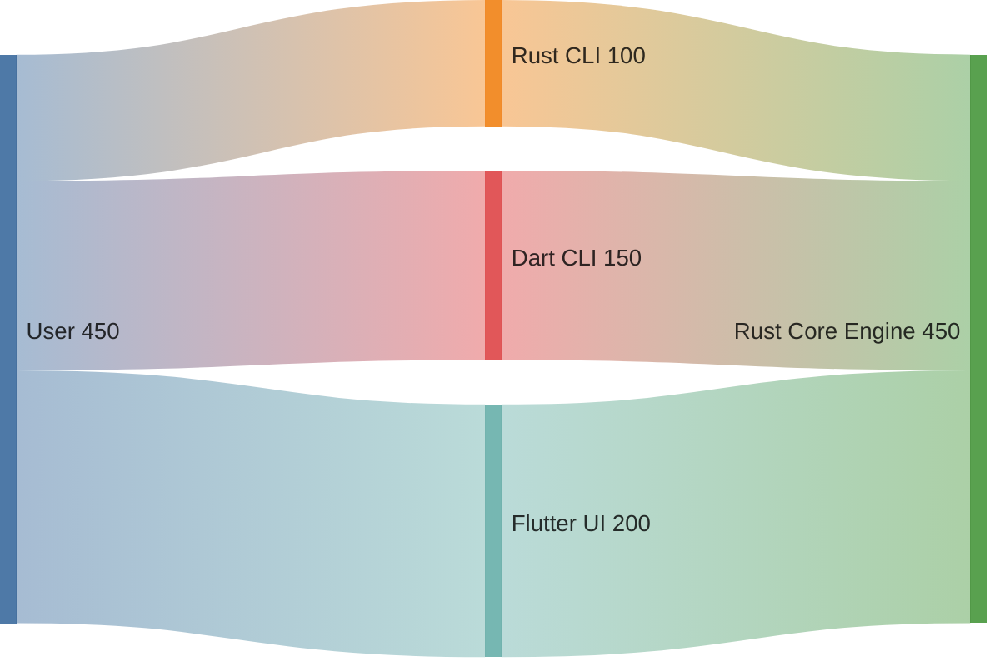
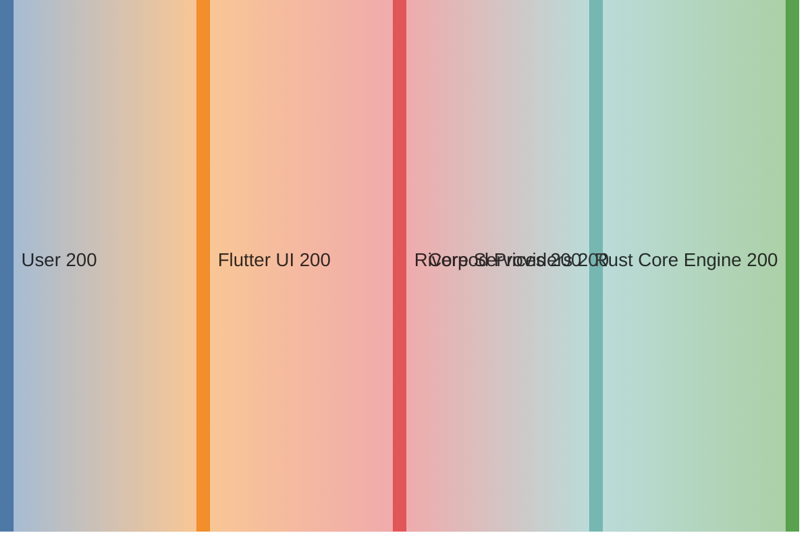
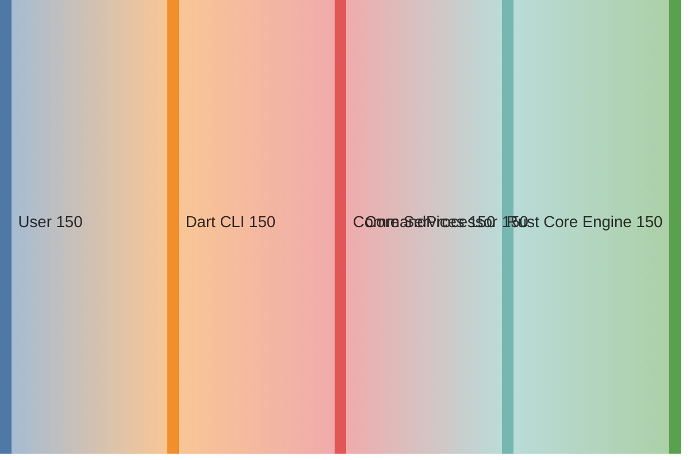
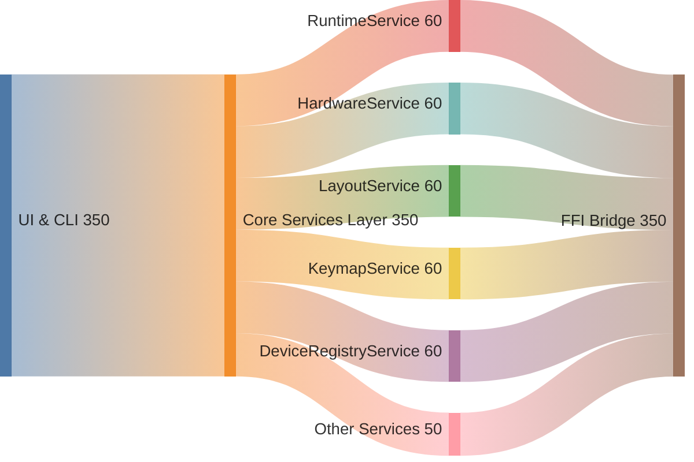
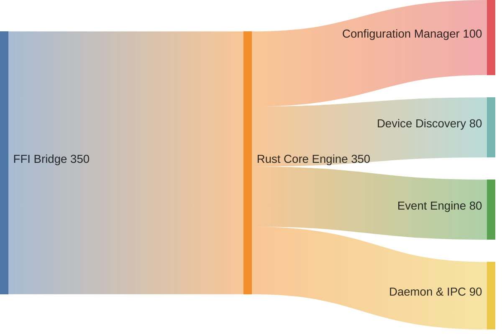
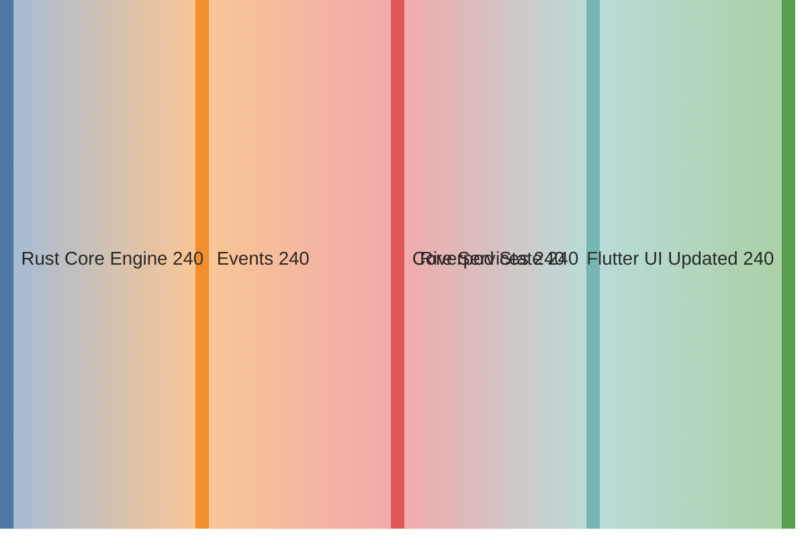

# KeyRx Architecture Data Flow Map

**Last Updated**: 2025-12-20
**Architecture**: Rust Core → FFI Bridge → Dart Core Logic → CLI/UI

---

## Overview

This visualization shows the complete data flow architecture of KeyRx across 6 abstraction layers:
1. **System Overview** - Three entry points converging to one engine
2. **Flutter UI Path** - How UI requests reach Rust
3. **Dart CLI Path** - How CLI commands reach Rust
4. **Core Services** - SSOT layer with 6 config services
5. **Rust Core** - Four major subsystems
6. **Reactive Flow** - How events propagate back to UI

Each diagram uses **max 4 layers** for clarity.

---

## Architecture Sankey Diagrams

### Layer 1: System Overview (High-Level)

**Three entry points, one core engine**



**Explanation**: Users interact via 3 interfaces (Rust CLI for system ops, Dart CLI for testing, Flutter UI for primary use). All converge to the Rust Core Engine.

---

### Layer 2: Request Flow - Flutter UI Path

**How UI requests reach Rust (4 layers)**



**Path**: `User → Flutter UI → Riverpod (state) → Core Services (SSOT) → Rust Core`

---

### Layer 3: Request Flow - Dart CLI Path

**How CLI commands reach Rust (4 layers)**



**Path**: `User → Dart CLI → CommandProcessor (JSON protocol) → Core Services → Rust Core`

---

### Layer 4: Core Services Breakdown

**Six configuration services in SSOT layer**



**Services**: All 6 config services are pure Dart, zero Flutter dependencies, shared by CLI and UI.

---

### Layer 5: Rust Core Components

**Four major Rust subsystems**



**Components**: Config persistence, device detection, event processing, background daemon.

---

### Layer 6: Reactive Flow (Events Back to UI)

**How Rust events propagate to UI (4 layers)**



**Path**: `Rust events → FFI callbacks → Core Services (StreamController) → Riverpod (notifyListeners) → UI rebuild`

---

## Data Flow Explanation

### 1. **User Input Paths**

#### Path A: Direct Rust CLI (Legacy)
```
User → Rust CLI (core/src/bin/keyrx/) → Rust Core Engine
```
- **Use Case**: Direct system-level operations
- **Volume**: 100 units
- **Latency**: Lowest (no FFI overhead)

#### Path B: Dart CLI (Headless Harness)
```
User → Dart CLI (apps/cli_tool/)
     → CommandProcessor
     → Core Services (packages/core_logic/)
     → Rust Core Engine
```
- **Use Case**: Configuration management, testing without UI
- **Volume**: 150 units
- **Latency**: Low (minimal FFI calls)
- **Commands**: 22 total (13 config + 9 device)

#### Path C: Flutter UI (Primary Interface)
```
User → Flutter UI (ui/)
     → Riverpod Providers
     → Core Services
     → Rust Core Engine
```
- **Use Case**: Full-featured graphical interface
- **Volume**: 200 units (primary user interface)
- **Latency**: Medium (UI rendering + FFI)
- **Reactivity**: Full reactive updates via streams

---

### 2. **Core Services Layer (SSOT)**

**Location**: `packages/core_logic/lib/services/`

All configuration and device management flows through these services:

| Service | Responsibility | LOC | Flutter Deps |
|---------|---------------|-----|--------------|
| `RuntimeService` | Runtime slot management | 177 | ❌ Zero |
| `HardwareService` | Hardware profile CRUD | 99 | ❌ Zero |
| `LayoutService` | Virtual layout CRUD | 92 | ❌ Zero |
| `KeymapService` | Keymap CRUD | 67 | ❌ Zero |
| `DeviceRegistryService` | Device registry & config | 350+ | ❌ Zero |

**Key Principle**: Pure Dart, no Flutter dependencies, shared by CLI and UI.

---

### 3. **UI Wrapper Pattern (ChangeNotifier Bridge)**

**Location**: `ui/lib/services/*_ui.dart`

Bridges core services (StreamController) to Flutter (ChangeNotifier):

```dart
// Core Service (pure Dart)
class HardwareService {
  StreamController<void> _changes = StreamController.broadcast();
  Stream<void> get changes => _changes.stream;

  Future<Result> saveProfile() {
    // ... FFI call
    _changes.add(null); // Notify listeners
  }
}

// UI Wrapper (Flutter)
class HardwareServiceUI extends ChangeNotifier {
  HardwareServiceUI(core.HardwareService core) {
    _subscription = core.changes.listen((_) => notifyListeners());
  }

  Future<Result> saveProfile() => _core.saveProfile(); // Forward
}
```

**Wrappers**:
- `HardwareServiceUI` → wraps `core.HardwareService`
- `LayoutServiceUI` → wraps `core.LayoutService`
- `DeviceRegistryServiceUI` → wraps `core.DeviceRegistryService`

---

### 4. **FFI Bridge Layer**

**Location**: `packages/core_logic/lib/ffi/bridge.dart`

Single gateway between Dart and Rust:

```dart
class KeyrxBridge {
  final KeyrxBindings bindings; // Generated FFI bindings

  bool initialize(); // Initialize Rust runtime

  // All core services use this bridge
}
```

**Volume**: 350 units (aggregated from all services)

---

### 5. **Rust Core Engine**

**Location**: `core/src/`

Four main components:

| Component | Responsibility | Data Flow |
|-----------|---------------|-----------|
| **Configuration Manager** | Runtime, Hardware, Layout, Keymap persistence | 100 units |
| **Device Discovery** | Linux evdev device detection & safety | 80 units |
| **Event Engine** | Key event processing & transformations | 80 units |
| **Daemon/IPC** | Background daemon & IPC protocol | 90 units |

---

### 6. **Reactive Flow (Rust → Dart → UI)**

Changes in Rust propagate back to UI:

```
Rust Core (config change)
  → Events
  → Core Services (StreamController.add)
  → Riverpod State (notifyListeners)
  → Flutter UI (rebuild)
```

**Volume**: 240 units (events/updates from Rust)

---

## Architecture Achievements

### ✅ Single Source of Truth (SSOT)
- All config services in `packages/core_logic/`
- Shared by CLI and UI
- No duplication

### ✅ Zero Flutter Dependencies in Core
- Core services use pure Dart (StreamController)
- CLI can use services without Flutter SDK
- Enables headless testing

### ✅ Layered Architecture
```
┌─────────────────────────────────────┐
│  Presentation (Flutter UI)          │
├─────────────────────────────────────┤
│  Adapters (UI Wrappers)             │
├─────────────────────────────────────┤
│  Business Logic (Core Services)     │  ← SSOT
├─────────────────────────────────────┤
│  Bridge (FFI Layer)                 │
├─────────────────────────────────────┤
│  Core (Rust Engine)                 │
└─────────────────────────────────────┘
```

### ✅ Dependency Injection
- `ServiceRegistry` wires all dependencies
- No globals, fully testable
- Easy to mock for tests

### ✅ CLI/UI Parity
- Dart CLI: 22 commands using core services
- Flutter UI: Full GUI using same services
- Rust CLI: Direct engine access for performance

---

## Key Design Patterns

### 1. **Wrapper Pattern**
- **Problem**: Core services use Streams, UI needs ChangeNotifier
- **Solution**: Thin UI wrappers that forward calls and bridge reactivity
- **Example**: `HardwareServiceUI` wraps `core.HardwareService`

### 2. **Repository Pattern**
- **Problem**: Decouple business logic from data persistence
- **Solution**: Repositories (e.g., `DeviceConfigRepository`) handle storage
- **Benefit**: Swappable storage backends

### 3. **Service Layer Pattern**
- **Problem**: Complex business logic in UI or Rust
- **Solution**: Dart services encapsulate config operations
- **Benefit**: Reusable across CLI and UI

### 4. **Bridge Pattern**
- **Problem**: Dart needs to call Rust safely
- **Solution**: Single `KeyrxBridge` with type-safe bindings
- **Benefit**: Centralized FFI management

---

## Data Flow Volumes (Relative)

| Flow Path | Volume | Latency | Use Case |
|-----------|--------|---------|----------|
| Rust CLI → Engine | 100 | Lowest | System ops |
| Dart CLI → Core → Engine | 150 | Low | Config mgmt |
| UI → Core → Engine | 200 | Medium | User interaction |
| Engine → Core → UI | 240 | Medium | Reactive updates |

---

## File Structure Map

```
keyrx/
├── core/                           # Rust Core Engine
│   ├── src/bin/keyrx/             # Rust CLI
│   ├── src/daemon/                # Daemon & IPC
│   ├── src/drivers/linux/         # Device discovery
│   ├── src/engine/                # Event processing
│   └── src/ffi/                   # FFI bindings (Rust side)
│
├── packages/core_logic/            # SSOT - Core Services
│   ├── lib/ffi/bridge.dart        # FFI Bridge (Dart side)
│   ├── lib/services/
│   │   ├── runtime_service.dart   # 177 lines, 0 Flutter deps
│   │   ├── hardware_service.dart  # 99 lines, 0 Flutter deps
│   │   ├── layout_service.dart    # 92 lines, 0 Flutter deps
│   │   ├── keymap_service.dart    # 67 lines, 0 Flutter deps
│   │   └── device_registry_service.dart
│   └── lib/repositories/          # Data persistence
│
├── apps/cli_tool/                  # Dart CLI
│   ├── bin/keyrx_cli.dart         # Entry point
│   └── lib/command_processor.dart # 22 commands
│
└── ui/                             # Flutter UI
    ├── lib/services/
    │   ├── service_registry.dart  # DI container
    │   ├── hardware_service_ui.dart    # Wrapper
    │   ├── layout_service_ui.dart      # Wrapper
    │   └── device_registry_service.dart # Wrapper
    └── lib/screens/               # UI screens
```

---

## Success Metrics

### Code Quality
- ✅ **Zero Flutter deps** in core services (verified with grep)
- ✅ **SSOT achieved**: All services in core_logic
- ✅ **DI pattern**: No globals, fully testable
- ✅ **Layered architecture**: Clear separation of concerns

### Functionality
- ✅ **CLI parity**: 22 commands (13 config + 9 device)
- ✅ **UI reactivity**: Full ChangeNotifier compatibility
- ✅ **Headless testing**: CLI can test without UI

### Maintainability
- ✅ **Single codebase** for business logic
- ✅ **Reusable services** across CLI and UI
- ✅ **Clear data flows** (visualized in 6 focused diagrams)

---

## Migration Path (Completed 2025-12-20)

### Spec 1: move-config-services-to-core ✅
- Moved RuntimeService, KeymapService to core_logic
- Zero refactoring needed (already pure Dart)

### Spec 2: refactor-flutter-services ✅
- Refactored HardwareService, LayoutService
- ChangeNotifier → StreamController
- Created UI wrappers for ChangeNotifier compatibility

### Spec 3: extend-cli-commands ✅
- Extended CommandProcessor with 13 new config commands
- CLI now has full config management capability

**Result**: Complete architectural transformation in 3 specs (19 tasks)

---

## Conclusion

This architecture achieves:

1. **Separation of Concerns**: UI, Business Logic, Core Engine clearly separated
2. **Code Reuse**: Core services shared by CLI and UI
3. **Testability**: Headless Dart CLI enables testing without Flutter
4. **Performance**: Direct Rust CLI for low-latency operations
5. **Reactivity**: Stream-based updates propagate through all layers
6. **Type Safety**: FFI bindings generated from Rust contracts

The 6 layered Sankey diagrams above visualize how **450+ units of user interaction flow through distinct architectural layers**, demonstrating a well-structured, maintainable system with clear separation of concerns at each level.
