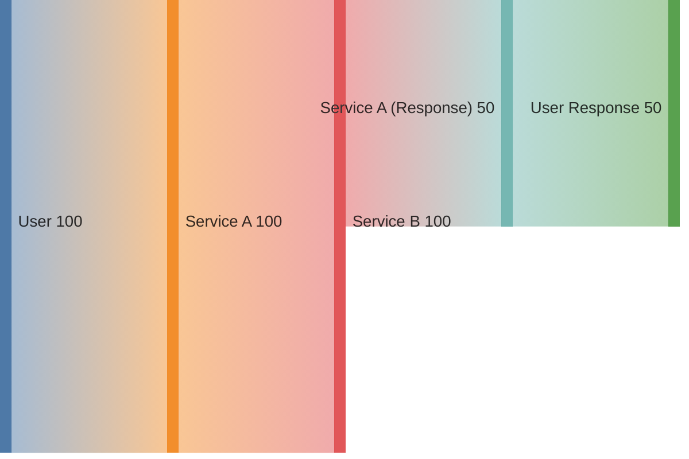

# Mermaid Diagram Validation

## Problem

Mermaid Sankey diagrams with circular references fail to render on GitHub with the error:
```
circular link
```

This happens because Sankey diagrams are designed for **unidirectional flow** only.

## Solution

Use the validation script **before committing** any markdown files with Mermaid diagrams:

```bash
node scripts/validate-mermaid-sankey.js <file.md>
```

## Example

### ❌ Invalid (Circular Reference)

```mermaid
sankey-beta

User,Service A,100
Service A,Service B,100
Service B,Service A,50  # ← CIRCULAR!
```

**Error:**
```
❌ ERROR: Circular reference detected!
   Cycle: Service A → Service B → Service A
```

### ✅ Valid (Separate Nodes)



## How It Works

The validator:

1. **Extracts Sankey diagrams** from markdown code blocks
2. **Parses edges** in format: `Source,Target,Value`
3. **Detects syntax errors**:
   - Wrong format: `Source,Value,Target` (incorrect)
   - Non-numeric values
4. **Detects circular references** using DFS graph traversal
5. **Reports all cycles** with full path

## Usage

### Validate Single File

```bash
node scripts/validate-mermaid-sankey.js docs/architect/api-map.md
```

### Validate All Markdown Files

```bash
find docs -name "*.md" -exec node scripts/validate-mermaid-sankey.js {} \;
```

### Add to Pre-commit Hook (Optional)

Add to `.git/hooks/pre-commit`:

```bash
# Step X: Validate Mermaid diagrams
echo "[X/Y] Validating Mermaid Sankey diagrams..."
for file in $(git diff --cached --name-only --diff-filter=ACM | grep '\.md$'); do
    if grep -q "sankey" "$file"; then
        if ! node scripts/validate-mermaid-sankey.js "$file"; then
            echo "    ❌ Mermaid validation failed"
            exit 1
        fi
    fi
done
echo "    ✓ Mermaid diagrams OK"
```

## Common Fixes

### Issue: Circular Flow

**Problem:** Trying to show bidirectional data flow
```
A → B → C → A  # Circular!
```

**Solution:** Use separate node names for return path
```
A → B → C → A (Response) → User  # Valid!
```

### Issue: Syntax Error

**Problem:** Wrong edge format
```
HardwareService,60,FFI Bridge  # Wrong order!
```

**Solution:** Correct format is `Source,Target,Value`
```
HardwareService,FFI Bridge,60  # Correct!
```

## Real Example

The `docs/architect/api-map.md` Sankey diagram was fixed by:

1. **Syntax fix:**
   ```diff
   - HardwareService,60,FFI Bridge
   + HardwareService,FFI Bridge,60
   ```

2. **Circular flow fix:**
   ```diff
   # Request path
   Core Services,FFI Bridge,350
   FFI Bridge,Rust Core Engine,350

   # Response path (was circular)
   - Rust Core Engine,Configuration Manager,100
   - Configuration Manager,FFI Bridge,80
   - FFI Bridge,Core Services,240  # ← Circular!

   # Fixed with separate nodes
   + Rust Core Engine,Configuration Manager,100
   + Configuration Manager,Events from Rust,80
   + Events from Rust,Core Services (Reactive),240
   ```

## Tool Requirements

- Node.js (already installed for this project)
- No additional dependencies (uses built-in modules)

## Future Enhancements

Possible improvements:

1. **Image rendering validation** using `@mermaid-js/mermaid-cli` (requires headless browser)
2. **Automatic fixing** of simple syntax errors
3. **Support for other diagram types** (flowchart, sequence, etc.)
4. **CI/CD integration** to block PRs with invalid diagrams

## Troubleshooting

### Script not executable

```bash
chmod +x scripts/validate-mermaid-sankey.js
```

### Node not found

```bash
which node
# If not found, install Node.js
```

### False positive cycles

If the validator reports a cycle incorrectly, please file an issue with:
- The diagram content
- Expected vs actual behavior
- Output from the validator
